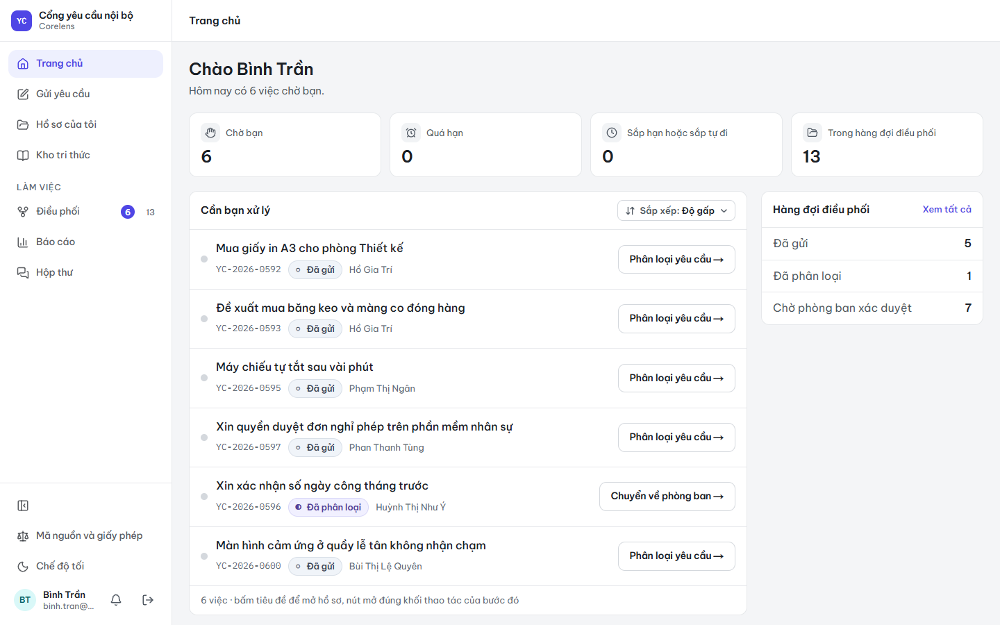

# Corelens

[Tiếng Việt](README.md) · **English**

[](LICENSES.md)

Corelens is an open source internal request portal for businesses. Broken equipment reports, software
access requests, employment certificates and purchase proposals all go to one place and follow a process
declared in data, not hard-coded. Under the portal sits a headless core platform (`/core/v1`, API only)
that other applications can reuse.

Documentation: **https://alavox-lab.github.io/corelens/** (in Vietnamese, like the user interface and the
sample data) · Entry for the Open Source Software track of the Vietnam Student Informatics Olympiad 2026.



## What Corelens does

- **Case-by-case routing.** A coordinator classifies each request, sets its priority and picks the
  department; a department that gets the wrong case sends it back with a reason.
- **The process is data.** States, steps, roles, mistake-proofing guards and every number live in tables;
  changing the process means editing data, not code.
- **Deadlines in working hours.** Deadlines follow the working calendar and public holidays, scaled by
  priority; overdue cases escalate on their own.
- **Event log and process mining.** Every state change writes one append-only row; from that log the system
  rebuilds the process as it really runs and points at the bottlenecks.
- **AI only suggests.** An optional local language model suggests the type, priority and department; a
  person confirms before it becomes a decision.
- **Core platform `/core/v1`.** Other applications call it through the API gateway with a service account;
  working examples in [`examples/goi-loi/`](examples/goi-loi/).

The core assembles Keycloak, Apache APISIX, PostgreSQL, SeaweedFS and Apache Superset around a workflow
engine written by the team: [`docs/ARCHITECTURE.md`](docs/ARCHITECTURE.md). How each requirement of the
competition brief is met: [`docs/doi-chieu-de-thi.md`](docs/doi-chieu-de-thi.md).

## Try it

Needs Git and Docker with Compose v2 (Docker Desktop, or Docker Engine 24 or later).

```bash
git clone https://github.com/AlaVox-lab/corelens.git
cd corelens/infra
cp .env.example .env
docker compose --env-file .env up -d --build
```

On PowerShell use `Copy-Item` instead of `cp`. The first build takes about 10–20 minutes.

Open `http://localhost:3000`, click **Đăng nhập bằng tài khoản công ty** (sign in with your company
account), and sign in as `binh.tran` / `matkhau123` (coordinator). Accounts for the other roles:
[Sample accounts](https://alavox-lab.github.io/corelens/huong-dan/tai-khoan-mau/).

This is a demo stack: its passwords and sample accounts are public. Installing from a release archive,
hardware requirements, optional services and what to change before real use:
[Installation](https://alavox-lab.github.io/corelens/cai-dat/cai-dat/).

## Documentation

| Page | Contents |
|---|---|
| [Quick start](https://alavox-lab.github.io/corelens/bat-dau/bat-dau-nhanh/) | Build the stack and take one case through all four roles |
| [Installation and operations](https://alavox-lab.github.io/corelens/cai-dat/cai-dat/) | Requirements, configuration, language model, email, knowledge base, upgrades, backups |
| [User guides](https://alavox-lab.github.io/corelens/huong-dan/nguoi-gui/) | Requester, coordinator, department head, handler |
| [Core platform API](https://alavox-lab.github.io/corelens/tham-khao/api/) | `/core/v1`, service account tokens, processes as BPMN, safe retries |
| [Architecture](https://alavox-lab.github.io/corelens/phat-trien/kien-truc/) | Services in the stack, workflow engine, event log |

The documentation site's source is in [`docs-site/`](docs-site/). Technical documents that travel with the
code are in [`docs/`](docs/): project state, architecture decisions ([`docs/adr/`](docs/adr/)), the business
flow, dependencies and licenses. Changes per release: [`CHANGELOG.md`](CHANGELOG.md).

## Contributing

Read [`CONTRIBUTING.md`](CONTRIBUTING.md) before sending changes: branch model, Conventional Commits, SPDX
license headers. Report bugs and ideas in [Issues](https://github.com/AlaVox-lab/corelens/issues); report
security vulnerabilities privately as described in [`SECURITY.md`](SECURITY.md). Taking part means agreeing
to [`CODE_OF_CONDUCT.md`](CODE_OF_CONDUCT.md).

## Team

| Role | Member | Account |
|---|---|---|
| Faculty advisor | MSc. Trần Phước Đức | [`@tranphuocduc1998`](https://github.com/tranphuocduc1998) |
| Repository coordinator | Nguyễn Thanh Sơn | [`@AlaVox-lab`](https://github.com/AlaVox-lab) |
| Member | Nguyễn Thanh Nguyên | [`@NguyentimAnh`](https://github.com/NguyentimAnh) |

Work is split by [issue](https://github.com/AlaVox-lab/corelens/issues); nobody owns a fixed space.

## License

The repository follows a multi-license model: the code is under [MIT](LICENSE), except the process mining
service [`services/khai-pha/`](services/khai-pha/), which is [AGPL-3.0-or-later](services/khai-pha/LICENSE)
because it uses the PM4Py library; the rest of the system only talks to it over HTTP. Per-directory table in
[`LICENSES.md`](LICENSES.md), third-party notices in [`NOTICE`](NOTICE).
