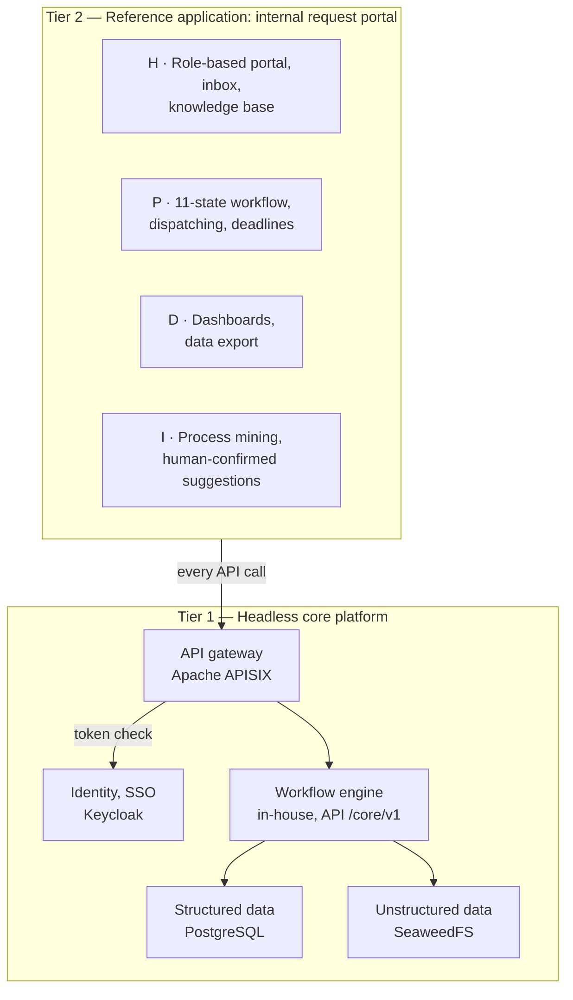

# dx-os-lab

[Tiếng Việt](README.md) · **English**

> A DX-OS Open-Core model: a **headless core platform** (identity, API gateway, data, workflow engine) and
> a **reference application** covering all four H-P-D-I spaces — an internal request operations portal
> for businesses. Entry for the Open Source Software track of the Vietnam Student Informatics Olympiad
> (OLP) 2026.

[](LICENSES.md)

The full documentation, the user interface and the sample data are in Vietnamese. This page is enough to
build and run the stack; see [Documentation](#documentation) for the rest.

---

## About

In many companies, internal requests — a broken laptop, a software licence, an employment certificate, a
purchase proposal — travel through chat apps, email or paper. Requesters cannot see where their request
is, nobody is reminded when it is overdue, and managers have no numbers on which step is slow.

**The dx-os-lab reference application is one portal for all of those requests.** A case moves between
four roles — requester, dispatcher, department head, handler — and each person sees their own queue as
soon as they log in. Underneath sits an API-only core platform that other applications can reuse. The
workflow is data, not code: states, transitions, roles, error-proofing (Poka-yoke) rules and every
threshold live in database tables. Every state change appends a row to an event log, from which the system
mines the process that actually runs and points out bottlenecks.

## Architecture: headless core and reference application

The competition brief requires a two-tier DX-OS Open-Core model:



**Tier 1 — core services** (API only, no screens):

| Required core service | Provided by | License |
|---|---|---|
| Identity, single sign-on | Keycloak `26.7.3`; optional two-factor authentication | Apache-2.0 |
| API gateway | Apache APISIX `3.20.0` — the single entry point, token check at the edge, rate limiting | Apache-2.0 |
| Structured and unstructured data | PostgreSQL + pgvector; SeaweedFS `4.45` over the S3 API | PostgreSQL License · Apache-2.0 |
| Workflow engine | **In-house state machine** running several processes side by side — each process is data, not code — exposed under `/core/v1`; every transition appends to the event log | MIT |

**Tier 2 — reference application**: H (Next.js portal, optional Wiki.js `2.5.315` knowledge base),
P (classification, routing, escalation, process configuration screen), D (Apache Superset `6.1.0`
dashboards embedded in the portal, CSV/JSON export, monthly cold storage), I (process mining with PM4Py
`2.7.23.8` in a separate AGPL service, optional local language model llama.cpp + Qwen2.5-1.5B). The
intelligence layer only writes *suggested* fields; a human confirms before anything becomes a decision.

## Quick start

You need Docker Engine 24+ with Compose v2 (or Docker Desktop), about 2 GB of RAM, 6 GB of disk, and free
ports 3000 · 8080 · 8088 · 8333 · 9080.

Download **Source code (tar.gz)** of the latest release from the
[Releases](https://github.com/AlaVox-lab/dx-os-lab/releases) page, then (replace `1.0.0` with the version
you downloaded):

```bash
tar -xzf dx-os-lab-1.0.0.tar.gz
cd dx-os-lab-1.0.0/infra
cp .env.example .env
docker compose --env-file .env up -d --build
```

On PowerShell use `Copy-Item .env.example .env` and `cd dx-os-lab-1.0.0\infra`. From a clone, run the last
three commands in `dx-os-lab/infra`. The first build takes about 10–20 minutes.

Open `http://localhost:3000` and click **Đăng nhập bằng tài khoản công ty** (*Sign in with company
account*). Sample accounts, shared password `matkhau123`:

| Account | Role |
|---|---|
| `an.nguyen` | Requester |
| `binh.tran` | Dispatcher |
| `dung.pham` | Head of IT department |
| `cuong.le` | IT handler |
| `khanh.vo` | Administrator — System and Process configuration screens |

To get numbers on the dashboards, load a few hundred demo cases — from the repository root:

```bash
python scripts/nap_du_lieu_trinh_dien.py --xac-nhan
```

Ports exposed on the host: `3000` portal · `9080` **API gateway** (API docs at `http://localhost:9080/docs`;
every route except health and docs needs a Keycloak access token) · `8080` Keycloak · `8088` Superset ·
`8333` SeaweedFS S3. The application service (`8000`) and PostgreSQL (`5432`) stay inside the Compose
network; developers who need them add a second file:

```bash
docker compose --env-file .env -f docker-compose.yml -f docker-compose.phat-trien.yml up -d   # in infra/
```

The default stack is a **demo**: passwords, keys and sample accounts are public. Read *Trước khi dùng thật*
(*Before real use*) in the Vietnamese README before putting real users on it. Report security issues as
described in [`SECURITY.md`](SECURITY.md).

## Core API

Another application can use the core without the portal: get a token with a Keycloak service account
(client credentials flow), then call `/core/v1` through the API gateway. Runnable examples using only the
Python standard library are in [`examples/goi-loi/`](examples/goi-loi/), with the stack running:

```bash
python examples/goi-loi/goi_loi.py             # create a case and take one transition
python examples/goi-loi/quy_trinh_mua_sam.py   # a second process: two-level purchase approval, API only
python examples/goi-loi/nhan_webhook.py        # receive signed event webhooks (needs the administrator role)
```

The same thing by hand (bash; replace the secret if you changed `KEYCLOAK_INTEGRATION_SECRET` in
`infra/.env`):

```bash
TOKEN=$(curl -s -d grant_type=client_credentials \
  -d client_id=dx-integration -d client_secret=doi_bi_mat_nay_truoc_khi_trien_khai \
  http://localhost:8080/realms/dx-os-lab/protocol/openid-connect/token \
  | python3 -c "import json, sys; print(json.load(sys.stdin)['access_token'])")
curl -H "Authorization: Bearer $TOKEN" http://localhost:9080/core/v1/workflow/request-types
```

The full endpoint list is in the OpenAPI page at `http://localhost:9080/docs`; the core/application
boundary is described in [`docs/ARCHITECTURE.md`](docs/ARCHITECTURE.md) section 2.3.

## Optional profiles

The default stack runs fully manually and downloads nothing beyond its pinned images. Each optional service
is one Compose profile plus a variable in `infra/.env` (commands run in `infra/`):

| Profile | Adds | Enable |
|---|---|---|
| `tri-tue` | Local language model (llama.cpp, MIT · Qwen2.5-1.5B-Instruct, Apache-2.0) for classification suggestions and similar cases; ~1.5 GB RAM, 2.4 GB disk | `python scripts/tai_mo_hinh.py` (repository root), set `LLM_URL=http://mo-hinh:8080` and `EMBEDDING_URL=http://mo-hinh-nhung:8080`, then `docker compose --env-file .env --profile tri-tue up -d` |
| `thu-thu` | Email notifications with the Mailpit test inbox (MIT) at `http://localhost:8025` | set `SMTP_HOST=thu-thu`, `SMTP_PORT=1025`, then `--profile thu-thu up -d` |
| `quet-tep` | Attachment malware scanning with ClamAV (GPL-2.0, separate service); ~1 GB RAM | set `CLAMAV_HOST=quet-tep`, then `--profile quet-tep up -d` |
| `tri-thuc` | Wiki.js knowledge base (AGPL-3.0, unmodified, separate service) with SSO; ~300 MiB RAM | `--profile tri-thuc up -d`, set `WIKI_URL=http://localhost:3100` |

Two-factor authentication (TOTP) is a Keycloak setting, toggled with `python scripts/xac_thuc_hai_lop.py bat`
(`tat` to disable). If the model, mail server or scanner is down, no case operation is blocked. Upgrading
an existing stack is `docker compose --env-file .env up -d --build`: migrations run on startup and no case,
event or attachment is lost.

## Documentation

The documentation site in [`docs-site/`](docs-site/) is written in Vietnamese and organised by reader:
getting started, installation and operations, user guides per role, administration, development and
reference. To view it locally (Node.js 22.12+):

```bash
cd docs-site
npm ci
npm run dev
```

Technical documents in the repository: [`docs/ARCHITECTURE.md`](docs/ARCHITECTURE.md) (how the system is
organised and why), [`docs/doi-chieu-de-thi.md`](docs/doi-chieu-de-thi.md) (each requirement of the brief and
how it is met), [`docs/adr/`](docs/adr/) (architecture decision records),
[`docs/dependencies.md`](docs/dependencies.md) (dependencies and licenses),
[`CHANGELOG.md`](CHANGELOG.md) (generated from the commit history).

## Contributing

Read [`CONTRIBUTING.md`](CONTRIBUTING.md) (Vietnamese): branch model (`dev` for integration, `main` for
releases), Conventional Commits, SPDX license headers in every source file, H-P-D-I issue labels, linters
and continuous integration. Issues and pull requests in English are welcome. Participation means agreeing
to the [`CODE_OF_CONDUCT.md`](CODE_OF_CONDUCT.md).

## Team

| Role | Member | Account |
|---|---|---|
| Faculty advisor | MSc. Trần Phước Đức | [`@tranphuocduc1998`](https://github.com/tranphuocduc1998) |
| Repository coordinator | Nguyễn Thanh Sơn | [`@AlaVox-lab`](https://github.com/AlaVox-lab) |
| Member | Nguyễn Phạm Đại Phúc | [`@phuctiensinh`](https://github.com/phuctiensinh) |
| Member | Nguyễn Thanh Nguyên | [`@NguyentimAnh`](https://github.com/NguyentimAnh) |

## License

The repository follows a **multi-license** model — full table in [`LICENSES.md`](LICENSES.md):

| Part | License |
|---|---|
| Application service, portal, UI tests, scripts, infrastructure, documentation | [MIT](LICENSE) |
| Process mining service [`services/khai-pha/`](services/khai-pha/) | [AGPL-3.0-or-later](services/khai-pha/LICENSE) |

The process mining service uses the PM4Py library (AGPL), so that whole directory is AGPL; the rest of the
system only exchanges JSON with it over HTTP. Every source file carries the SPDX identifier of its
directory's license. Third-party notices are in [`NOTICE`](NOTICE).
