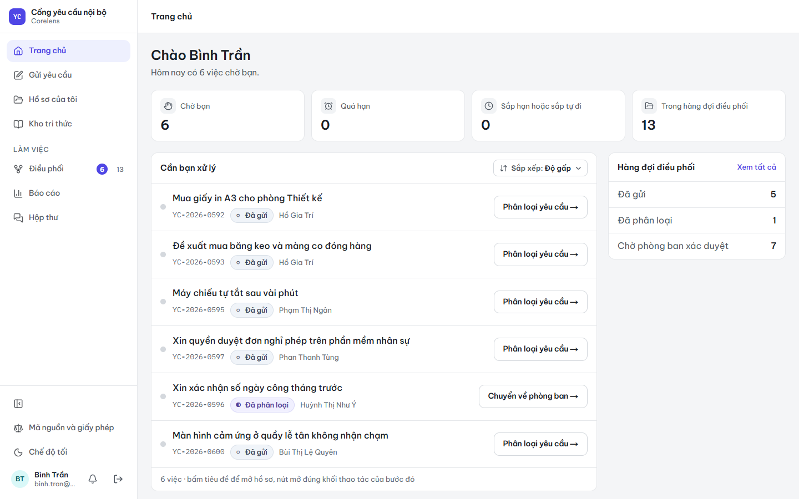
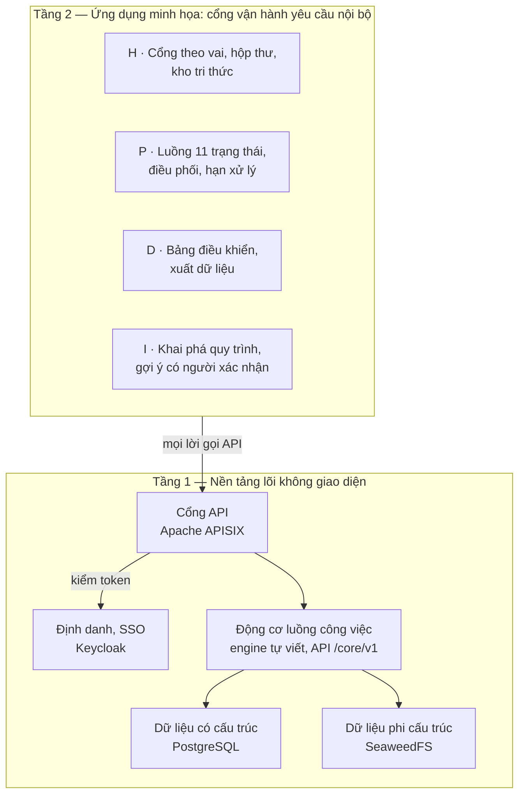

# dx-os-lab

**Tiếng Việt** · [English](README.en.md)

> Mô hình DX-OS Open-Core: một **nền tảng lõi không giao diện** (định danh, cổng API, dữ liệu, luồng
> công việc) và một **ứng dụng minh họa** phủ đủ H-P-D-I — cổng vận hành yêu cầu nội bộ cho doanh nghiệp.
> Dự án dự thi Phần mềm nguồn mở, Olympic Tin học Sinh viên Việt Nam 2026.

[](LICENSES.md)

**Giấy phép:** mã theo [MIT](LICENSE), riêng dịch vụ khai phá quy trình `services/khai-pha/` theo
AGPL-3.0-or-later — bảng theo thư mục ở [`LICENSES.md`](LICENSES.md), thông báo bên thứ ba ở
[`NOTICE`](NOTICE).

**Tài liệu đầy đủ:** trang tài liệu trong [`docs-site/`](docs-site/) — bắt đầu nhanh, cài đặt, hướng
dẫn theo từng vai, quản trị và tùy biến, phát triển. Cách xem ở mục [Tài liệu](#tài-liệu).

---

## Giới thiệu

Ở nhiều doanh nghiệp, việc nội bộ — báo máy hỏng, xin cấp phần mềm, xin giấy xác nhận, đề xuất mua
vật tư — được gửi qua Zalo, email hay giấy tờ. Người gửi không biết yêu cầu đã tới đâu, quá hạn không
ai nhắc, và lãnh đạo không có số liệu để biết khâu nào đang chậm.

**Ứng dụng minh họa của dx-os-lab là một cổng chung cho mọi yêu cầu đó.** Một hồ sơ đi qua bốn vai —
người gửi, điều phối viên, trưởng phòng, người xử lý — và mỗi người mở cổng lên là thấy ngay việc đang
chờ mình. Phía dưới cổng là nền tảng lõi chỉ có API, dùng lại được cho ứng dụng khác.



- **Điều phối theo từng hồ sơ** — điều phối viên phân loại, đặt mức ưu tiên và chọn phòng phù hợp;
  phòng sai chuyên môn thì trả lại kèm lý do. Không phải chuỗi người duyệt cố định
- **Quy trình là dữ liệu** — trạng thái, bước đi, vai trò, ràng buộc chống sai (Poka-yoke) và mọi con
  số nằm trong bảng. Đổi quy trình cho doanh nghiệp khác là sửa dữ liệu, không sửa mã
- **Hạn theo giờ làm việc** — nhân hệ số theo mức ưu tiên; quá hạn tự leo thang; hồ sơ nằm im thì
  hệ thống báo trước rồi tự đi
- **Vòng phản hồi tự soi quy trình** — mọi lần chuyển trạng thái ghi một dòng nhật ký sự kiện chỉ ghi
  thêm; từ nhật ký, hệ thống khai phá lại quy trình đang chạy thật và chỉ ra điểm nghẽn

So sánh với các sản phẩm cùng loại: [`docs/so-sanh-san-pham.md`](docs/so-sanh-san-pham.md).

## Kiến trúc: lõi không giao diện và ứng dụng minh họa

Đề thi yêu cầu mô hình DX-OS Open-Core hai tầng bắt buộc. Dự án đáp ứng như sau:



**Tầng 1 — nền tảng lõi**, chỉ có API, không có màn hình nào:

| Dịch vụ lõi đề bắt buộc | Đáp ứng bằng | Giấy phép |
|---|---|---|
| Định danh, đăng nhập một lần | Keycloak `26.7.3`; xác thực hai lớp tùy chọn | Apache-2.0 |
| Cổng API | Apache APISIX `3.20.0` — cửa vào duy nhất, kiểm token tại biên, giới hạn tốc độ | Apache-2.0 |
| Dữ liệu có cấu trúc và phi cấu trúc | PostgreSQL + pgvector; SeaweedFS `4.45` qua S3 API | PostgreSQL License · Apache-2.0 |
| Động cơ luồng công việc | **Engine máy trạng thái tự viết**, chạy **nhiều quy trình** cùng lúc — mỗi quy trình là dữ liệu, không mã riêng — phơi qua API của lõi `/core/v1`; mọi bước chuyển ghi nhật ký sự kiện chỉ ghi thêm | MIT |

**Tầng 2 — ứng dụng minh họa**, phủ bốn không gian:

| | Không gian | Có gì | Nền tảng lắp ghép |
|---|---|---|---|
| **H** | Nhân sự | Cổng theo vai, hộp thư trao đổi, ủy quyền khi vắng, kho tri thức (tùy chọn) | Next.js; Wiki.js `2.5.315` (AGPL-3.0, dịch vụ riêng) |
| **P** | Quy trình | Phân loại, định tuyến, leo thang, mở lại có giới hạn, màn cấu hình quy trình | — |
| **D** | Dữ liệu | Bảng điều khiển nhúng trong cổng, xuất nhật ký CSV, JSON và XES, lưu trữ lạnh theo tháng ra kho đối tượng, [phả hệ dữ liệu](docs/pha-he-du-lieu.md) | Apache Superset `6.1.0` (Apache-2.0) |
| **I** | Trí tuệ | Khai phá quy trình thực tế, gợi ý phân loại và người xử lý, hồ sơ tương tự | PM4Py `2.7.23.8` (AGPL-3.0, chỉ trong dịch vụ khai phá riêng); llama.cpp + Qwen2.5-1.5B (tùy chọn) |

Một ứng dụng khác dùng lõi mà không cần cổng người dùng: lấy token bằng tài khoản dịch vụ rồi gọi
`/core/v1` qua cổng API — ví dụ chạy được ở [`examples/goi-loi/`](examples/goi-loi/), kể cả một quy trình
thứ hai (đề xuất mua sắm duyệt hai cấp) chạy trọn chỉ qua lõi, không màn hình nào. Nền tảng phổ thông
được lắp ghép và chạy như dịch vụ độc lập; engine quy trình — phần tạo khác biệt — nhóm tự viết. Tầng `I`
chỉ ghi vào trường gợi ý, con người xác nhận mới thành quyết định.

Bảng đối chiếu từng yêu cầu của đề, kể cả phần để ngoài phạm vi:
[`docs/doi-chieu-de-thi.md`](docs/doi-chieu-de-thi.md). Lý do từng lựa chọn: [`docs/adr/`](docs/adr/).

## Cài nhanh

Cần Docker Engine 24 trở lên kèm Compose v2 (hoặc Docker Desktop), khoảng 2 GB bộ nhớ, 6 GB ổ
đĩa, và các cổng 3000 · 8080 · 8088 · 8333 · 9080 đang trống.
Các lệnh `python scripts/...` bên dưới cần thêm Python 3.10 trở lên (chỉ thư viện chuẩn, không cần
`pip install`); trên Ubuntu và Debian gõ `python3` thay cho `python`. Cụm tự nó không cần Python. Riêng
`scripts/quet_giay_phep.py` (quét giấy phép, CI chạy) cần 3.11 vì đọc cấu hình bằng `tomllib`.

Tải **Source code (tar.gz)** của bản mới nhất ở trang
[Releases](https://github.com/AlaVox-lab/dx-os-lab/releases), rồi (thay `1.0.0` bằng phiên bản đã tải):

```bash
tar -xzf dx-os-lab-1.0.0.tar.gz
cd dx-os-lab-1.0.0/infra
cp .env.example .env
docker compose --env-file .env up -d --build
```

Trên PowerShell dùng `Copy-Item .env.example .env` và `cd dx-os-lab-1.0.0\infra`. Từ kho mã thì
`git clone` rồi chạy ba lệnh cuối trong `dx-os-lab/infra`. Lần đầu mất khoảng 10–20 phút.

Mở `http://localhost:3000`, bấm **Đăng nhập bằng tài khoản công ty**. Tài khoản mẫu, mật khẩu chung
`matkhau123`:

| Tài khoản | Vai |
|---|---|
| `an.nguyen` | Người gửi |
| `binh.tran` | Điều phối viên |
| `dung.pham` | Trưởng phòng Công nghệ thông tin |
| `cuong.le` | Người xử lý Công nghệ thông tin |
| `khanh.vo` | Quản trị viên — màn Hệ thống, Cấu hình quy trình |

Bảng điều khiển phân tích ở mục **Báo cáo** của cổng: trưởng phòng thấy số của phòng mình, điều phối
viên và quản trị viên thấy toàn công ty. Người dựng báo cáo sửa bảng điều khiển trên Superset ở
`http://localhost:8088` (tài khoản quản trị trong `.env`). Muốn có số để xem, nạp vài trăm hồ sơ giả
vào cụm thử — chạy ở gốc kho mã:

```bash
python scripts/nap_du_lieu_trinh_dien.py --xac-nhan
```

Cổng mở ra máy: `3000` cổng người dùng · `9080` **cổng API** — cửa vào duy nhất của API, tài liệu API ở
`http://localhost:9080/docs`, mọi đường trừ kiểm tra sức khỏe và tài liệu cần access token của Keycloak ·
`8080` Keycloak · `8088` Superset · `8333` S3 của SeaweedFS. Dịch vụ ứng dụng (`8000`) và PostgreSQL
(`5432`) chỉ nghe trong mạng Compose; người phát triển cần gọi thẳng thì thêm tệp thứ hai:

```bash
docker compose --env-file .env -f docker-compose.yml -f docker-compose.phat-trien.yml up -d   # trong infra/
```

Đủ mười ba tài khoản, kiểm cụm, cấu hình, sự cố thường gặp và nâng cấp: xem trang tài liệu, phần
*Cài đặt và vận hành*.

### Mô hình ngôn ngữ (tùy chọn)

Cụm mặc định chạy **thủ công hoàn toàn**, không tải mô hình nào. Muốn điều phối viên nhận gợi ý loại yêu
cầu, mức ưu tiên và phòng ban, bật mô hình ngôn ngữ cục bộ (llama.cpp server, MIT · Qwen2.5-1.5B-Instruct,
Apache-2.0) — cần thêm khoảng 1,5 GB bộ nhớ và 2,4 GB ổ đĩa:

```bash
python scripts/tai_mo_hinh.py          # ở gốc kho mã: tải hai tệp mô hình vào volume Docker, kiểm SHA-256
# trong infra/.env đặt: LLM_URL=http://mo-hinh:8080 và EMBEDDING_URL=http://mo-hinh-nhung:8080
docker compose --env-file .env --profile tri-tue up -d   # trong infra/
```

`LLM_URL` bật gợi ý phân loại và khuyến nghị cải tiến trên màn Quy trình thực tế; `EMBEDDING_URL` (mô hình
nhúng Qwen3-Embedding-0.6B, Apache-2.0) bật gợi ý hồ sơ đã giải quyết tương tự trên biểu mẫu Gửi yêu cầu.

Tắt: để `LLM_URL` rỗng rồi `docker compose --env-file .env up -d`. Mô hình chỉ gợi ý — người vẫn
bấm xác nhận; mô hình tắt hay chậm thì không có gợi ý, không thao tác nào bị chặn. **`down -v` xóa cả tệp
mô hình**, phải chạy lại `scripts/tai_mo_hinh.py`. Biến môi trường, kết quả đo độ chính xác: trang tài
liệu, *Cài đặt và vận hành → Mô hình ngôn ngữ*.

### Thông báo thư và quét mã độc (tùy chọn)

Hai dịch vụ tùy chọn khác, cũng tắt mặc định — mỗi cái một hồ sơ Compose và một biến trong `infra/.env`:

```bash
# Thông báo thư, kèm hộp thư thử Mailpit (MIT) — xem thư ở http://localhost:8025
# trong infra/.env đặt: SMTP_HOST=thu-thu và SMTP_PORT=1025
docker compose --env-file .env --profile thu-thu up -d    # trong infra/

# Quét mã độc tệp đính kèm bằng ClamAV (GPL-2.0, dịch vụ riêng, thêm ~1 GB bộ nhớ)
# trong infra/.env đặt: CLAMAV_HOST=quet-tep
docker compose --env-file .env --profile quet-tep up -d   # trong infra/
```

Máy chủ thư hay ClamAV hỏng thì thao tác trên hồ sơ vẫn chạy: thư nằm chờ và được thử lại; tệp được nhận
kèm nhãn "chưa quét" (đổi bằng `CLAMAV_ON_UNAVAILABLE=reject`). Chi tiết: trang tài liệu, *Cài đặt và vận
hành → Thông báo thư và quét mã độc*.

### Kho tri thức (tùy chọn)

Wiki nội bộ để phòng ban viết hướng dẫn tự xử lý — Wiki.js (AGPL-3.0, chạy nguyên bản như dịch vụ độc lập),
đăng nhập một lần bằng tài khoản công ty, thêm khoảng 300 MiB bộ nhớ. Trong `infra/`:

```bash
docker compose --env-file .env --profile tri-thuc up -d
```

Lần đầu, bước khởi tạo tự cài Wiki.js, nối đăng nhập qua Keycloak, tạo nhóm theo vai trò (mọi nhân viên đọc;
điều phối viên, trưởng phòng, quản trị viên viết) và ba bài hướng dẫn mẫu. Đặt `WIKI_URL=http://localhost:3100`
trong `infra/.env` thì thanh bên của cổng có lối **Kho tri thức** (vào thẳng, không hỏi mật khẩu lần nữa), và —
khi mô hình nhúng cũng bật — bài hướng dẫn hiện trong gợi ý lúc người gửi đang soạn yêu cầu. Chi tiết: trang
tài liệu, *Cài đặt và vận hành → Kho tri thức*.

### Xác thực hai lớp (tùy chọn)

Bật mã dùng một lần (TOTP) khi đăng nhập cho mọi tài khoản công ty chỉ bằng cấu hình Keycloak, không sửa
mã nền tảng — ở gốc kho mã:

```bash
python scripts/xac_thuc_hai_lop.py bat          # tắt lại: tat · xem: trang-thai
```

Lần đăng nhập kế, người dùng quét mã QR bằng ứng dụng xác thực. Mặc định tắt nên cụm trình diễn không
đổi. Chi tiết: trang tài liệu, *Cài đặt và vận hành → Xác thực hai lớp*.

### Nâng cấp

Cụm dựng từ `v0.9.1` trở đi lên bản mới **mà không mất hồ sơ, nhật ký hay tệp đính kèm**: lược đồ do
migration quản lý và tự chạy lúc dịch vụ khởi động, dữ liệu cấu hình chỉ nạp lần đầu. Theo thứ tự:

1. Muốn chứng minh không mất gì, chụp số liệu **trước** khi lấy mã mới — ở gốc kho mã:
   `python scripts/kiem_nang_cap.py chup truoc-nang-cap.json`
2. Giải nén bản mới (hoặc `git pull`). Chép sang `infra/.env` mọi biến có trong `.env.example` mà `.env`
   chưa có — lệnh dưới in tên chúng; biến thiếu thì Compose dùng giá trị mặc định, nhưng có biến không có
   mặc định (đoạn sau danh sách này):

   ```bash
   python -c "k=lambda p:{l.split('=')[0] for l in open(p,encoding='utf-8') if '=' in l and not l.startswith('#')};print(*sorted(k('infra/.env.example')-k('infra/.env')))"
   ```

3. Trong `infra/`: `docker compose --env-file .env up -d --build`
4. So số liệu ở gốc kho mã: `python scripts/kiem_nang_cap.py so truoc-nang-cap.json`

Keycloak chỉ nạp realm lúc tạo, nên cụm dựng từ `v1.0.0` trở về trước chạy thêm hai lệnh một lần — tạo
tài khoản dịch vụ của ví dụ quy trình thứ hai và bật chống dò mật khẩu. Lệnh đầu chỉ tạo hai client
`dx-integration-truong-phong`, `dx-integration-duyet` khi `.env` đã có các dòng `KEYCLOAK_INTEGRATION_HEAD_*`
và `KEYCLOAK_INTEGRATION_REVIEWER_*` (bước 2); thiếu thì nó vẫn báo xong mà bỏ qua hai client đó:

```bash
python scripts/tai_khoan_dich_vu.py
python scripts/xac_thuc_hai_lop.py chong-do
```

Cụm dựng từ bản cũ hơn `v0.9.1` thì phải dựng lại (`down -v`). Hạn, mức ưu tiên, loại yêu cầu và phòng ban
sửa ngay trên màn **Cấu hình quy trình** của quản trị viên. Đổi đồ thị quy trình trên cụm đang chạy là một
bản sửa dữ liệu tạo bộ quy tắc phiên bản mới — hồ sơ đang chạy giữ luật cũ; khuôn mẫu ở
[`docs/ARCHITECTURE.md`](docs/ARCHITECTURE.md) mục 5.4.

### Sao lưu và khôi phục

Sao lưu tay ba cơ sở dữ liệu và kho tệp đính kèm trong **cùng một lần** (cụm ngừng nhận thao tác khoảng
20 giây), khôi phục dưới 15 phút, kèm đối soát số hồ sơ, nhật ký và tệp — ở gốc kho mã:

```bash
python scripts/sao_luu.py tao sao-luu/2026-12-09
python scripts/sao_luu.py khoi-phuc sao-luu/2026-12-09
```

Khôi phục thay **toàn bộ** dữ liệu của cụm, kể cả tài khoản Keycloak; cụm đích dùng cùng phiên bản mã và
cùng `infra/.env`. Chi tiết: trang tài liệu, *Cài đặt và vận hành → Sao lưu và khôi phục*.

### Trước khi dùng thật

Cụm dựng từ `.env.example` là cụm **trình diễn**: mật khẩu, khóa và mười ba tài khoản mẫu đều công khai.
Hệ thống không tự chặn chúng — người cài thường tạo thêm tài khoản thử của riêng mình, và không phần
mềm nào đoán đúng được tài khoản nào là mẫu. Trước khi đưa người dùng thật vào:

1. Trong `infra/.env`, đổi mọi giá trị ghi "BẮT BUỘC đổi": mật khẩu cơ sở dữ liệu, khóa kho tệp, bí mật
   của các client, khóa phiên, khóa Superset, mật khẩu quản trị Keycloak và Superset (`admin/admin`).
2. Trong Keycloak (`http://localhost:8080`, realm `dx-os-lab`), xóa các tài khoản mẫu, chỉ giữ một tài
   khoản quản trị, rồi tạo tài khoản thật theo nhu cầu. Tắt (hoặc đổi bí mật) ba client tích hợp mẫu
   `dx-integration`, `dx-integration-truong-phong`, `dx-integration-duyet` nếu không dùng — hai client sau
   chỉ để chạy ví dụ quy trình thứ hai.
3. Realm mẫu đã bật chống dò mật khẩu (khóa tạm sau 10 lần sai, tự mở) và chính sách mật khẩu tối thiểu 8
   ký tự; cụm dựng trước bản đó áp bằng `python scripts/xac_thuc_hai_lop.py chong-do`. Muốn chặt hơn, sửa
   *Realm settings → Security defenses* và *Authentication → Policies*. `sslRequired` để `none` vì cụm mẫu
   chạy `http://localhost`; khi đưa lên tên miền có HTTPS, đổi thành `external` (hoặc `all`).
4. Sao lưu một lần ngay sau khi cấu hình xong — mục [Sao lưu và khôi phục](#sao-lưu-và-khôi-phục).

Báo lỗ hổng bảo mật: [`SECURITY.md`](SECURITY.md).

## Tài liệu

**Trang tài liệu** ([`docs-site/`](docs-site/)) chia theo người đọc, tương tự trang tài liệu của các nền
tảng nguồn mở lớn:

| Phần | Cho ai |
|---|---|
| Bắt đầu | Người mới: giới thiệu, dựng cụm và đi trọn một hồ sơ |
| Cài đặt và vận hành | Người cài đặt: yêu cầu máy, cấu hình, sự cố, nâng cấp |
| Hướng dẫn sử dụng | Nhân viên: người gửi, điều phối viên, trưởng phòng, người xử lý, hộp thư, hạn xử lý |
| Quản trị và tùy biến | Quản trị viên: đổi quy trình, danh mục, các con số, màn Hệ thống |
| Phát triển, Tham khảo | Người đóng góp: kiến trúc, quy trình đóng góp, API, phát hành |

Xem trên máy (cần Node.js 22.12 trở lên):

```bash
cd docs-site
npm ci
npm run dev
```

rồi mở `http://localhost:4321/`. Trang đăng lên GitHub Pages khi kho chuyển công khai — cách đăng ở
[`CONTRIBUTING.md`](CONTRIBUTING.md) mục *Đăng trang tài liệu*.

Tài liệu kỹ thuật trong kho:

| Tài liệu | Trả lời |
|---|---|
| [`docs/PROJECT_STATE.md`](docs/PROJECT_STATE.md) | Dự án đang ở đâu, vừa làm gì, đang vướng gì |
| [`docs/ARCHITECTURE.md`](docs/ARCHITECTURE.md) | Hệ thống tổ chức thế nào và vì sao |
| [`docs/doi-chieu-de-thi.md`](docs/doi-chieu-de-thi.md) | Dự án đáp ứng từng yêu cầu của đề thi OLP 2026 bằng gì, còn thiếu gì |
| [`docs/process-flow.md`](docs/process-flow.md) | Luồng nghiệp vụ: 11 trạng thái, 32 bước, cơ sở các con số |
| [`docs/ROADMAP.md`](docs/ROADMAP.md) | Việc tiếp theo |
| [`docs/adr/`](docs/adr/) | Vì sao chọn công nghệ đó |
| [`docs/dependencies.md`](docs/dependencies.md) | Phụ thuộc và giấy phép |
| [`CHANGELOG.md`](CHANGELOG.md) | Nhật ký thay đổi, sinh tự động từ lịch sử commit |

## Đóng góp

Đọc [`CONTRIBUTING.md`](CONTRIBUTING.md): mô hình nhánh, Conventional Commits, header giấy phép SPDX,
nhãn issue theo H-P-D-I, tích hợp liên tục. Tham gia dự án là đồng ý với
[`CODE_OF_CONDUCT.md`](CODE_OF_CONDUCT.md). Lỗ hổng bảo mật báo riêng theo [`SECURITY.md`](SECURITY.md).
Trợ lý AI lập trình đọc [`CLAUDE.md`](CLAUDE.md) (qua [`AGENTS.md`](AGENTS.md)).

## Đội ngũ

| Vai trò | Thành viên | Tài khoản |
|---|---|---|
| Giảng viên hướng dẫn | ThS. Trần Phước Đức | [`@tranphuocduc1998`](https://github.com/tranphuocduc1998) |
| Điều phối kho mã | Nguyễn Thanh Sơn | [`@AlaVox-lab`](https://github.com/AlaVox-lab) |
| Thành viên | Nguyễn Phạm Đại Phúc | [`@phuctiensinh`](https://github.com/phuctiensinh) |
| Thành viên | Nguyễn Thanh Nguyên | [`@NguyentimAnh`](https://github.com/NguyentimAnh) |

Công việc chia theo từng [issue](https://github.com/AlaVox-lab/dx-os-lab/issues), không cố định ai phụ
trách không gian nào.

## Giấy phép

Kho theo mô hình **nhiều giấy phép** — bảng đầy đủ ở [`LICENSES.md`](LICENSES.md):

| Phần | Giấy phép |
|---|---|
| Dịch vụ ứng dụng, cổng, kiểm thử giao diện, kịch bản, hạ tầng, tài liệu | [MIT](LICENSE) |
| Dịch vụ khai phá quy trình [`services/khai-pha/`](services/khai-pha/) | [AGPL-3.0-or-later](services/khai-pha/LICENSE) |

Dịch vụ khai phá dùng thư viện PM4Py (AGPL) nên cả thư mục theo AGPL; phần còn lại chỉ trao đổi JSON với
nó qua HTTP. Mọi tệp mã nguồn mang định danh SPDX đúng giấy phép của thư mục ở đầu tệp. Thông báo bên
thứ ba ở [`NOTICE`](NOTICE); danh mục phụ thuộc kèm giấy phép ở [`docs/dependencies.md`](docs/dependencies.md).
