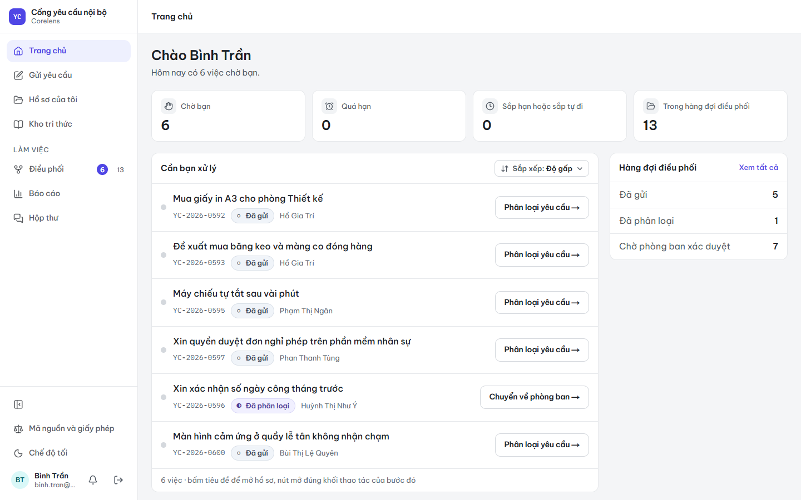
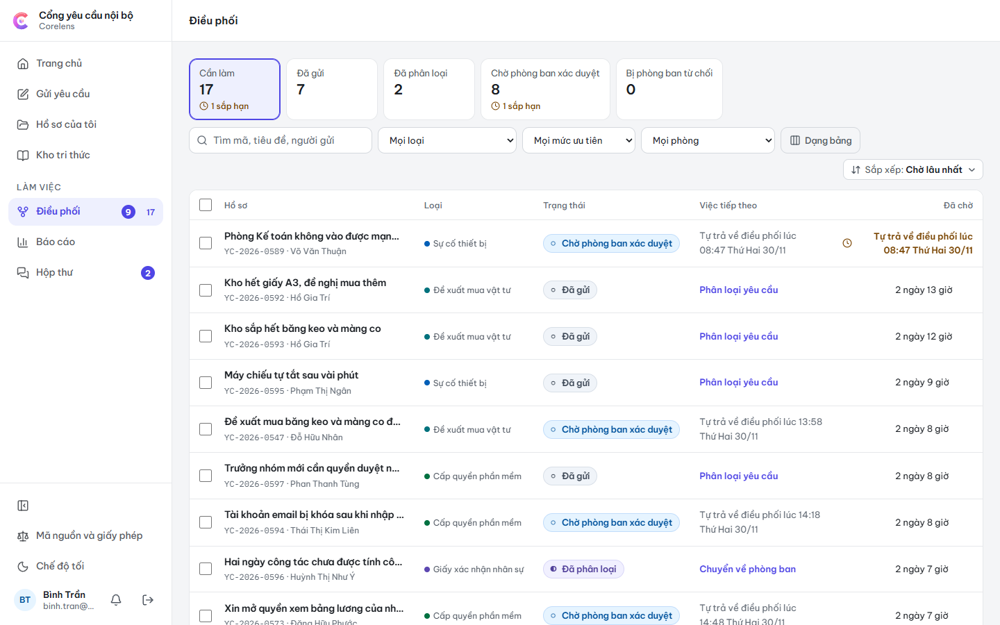

Điều phối viên là người đọc từng hồ sơ và quyết định **phòng nào làm**. Ví dụ dùng `binh.tran`.

## Trang chủ và hàng đợi

Trang chủ gom các hồ sơ đang chờ bạn, nút mang tên bước kế tiếp — *Phân loại yêu cầu*, *Chuyển về
phòng ban*. Mặc định xếp theo độ gấp; đổi được và trình duyệt nhớ.

Mục **Điều phối** (`/dieu-phoi`) là hàng đợi đầy đủ. Dải số trên đầu bấm để lọc theo trạng thái;
cột *Việc tiếp theo* cho biết bước kế của từng hồ sơ. Ô tìm khớp mã, tiêu đề, người gửi, gõ không
dấu vẫn ra; ba ô chọn lọc theo loại yêu cầu, mức ưu tiên, phòng. Bộ lọc đang bật hiện thành chip
bấm để bỏ. Mỗi trang 50 hồ sơ, dòng cuối ghi đang xem bao nhiêu trên tổng số; địa chỉ trang giữ
bộ lọc và trang đang xem, nên gửi đường dẫn cho đồng nghiệp là họ thấy đúng danh sách đó.

Bấm một dòng thì hồ sơ mở trong **ngăn xem nhanh** bên phải, danh sách vẫn ở nguyên chỗ. Ngăn có
hạn, nội dung, dòng thời gian, liên hệ người gửi; nút ở đáy là bước bạn cần làm, các thao tác khác
nằm trong *Thao tác khác*. Làm xong thì ngăn tự sang hồ sơ kế. Phím mũi tên lên/xuống chuyển hồ
sơ, Esc đóng ngăn; *Mở trang đầy đủ* để xem trao đổi và tệp đính kèm.

## Một hồ sơ qua tay điều phối

1. **Phân loại yêu cầu** — xác nhận hay sửa loại người gửi chọn, và **đặt mức ưu tiên** (Khẩn,
   Cao, Bình thường, Thấp). Mức ưu tiên quyết định hạn xử lý
2. **Chuyển về phòng ban** — chọn phòng phụ trách. Hệ thống gợi ý theo loại yêu cầu, bạn chọn khác
   được
3. Thiếu thông tin thì **Yêu cầu bổ sung thông tin** trước khi phân loại — người gửi trả lời xong,
   hồ sơ quay về đúng chỗ bạn hỏi

## Làm hàng loạt

Nhiều hồ sơ cùng loại, cùng phòng thì không phải mở từng hồ sơ. Đầu mỗi dòng hàng đợi có một ô chọn;
ô ở đầu bảng chọn cả trang đang xem. Bấm ô chọn không mở ngăn xem nhanh — bấm phần còn lại của dòng
thì vẫn mở như cũ. Chọn chỉ trong trang đang xem: sang trang khác, tìm hay đổi bộ lọc là bỏ chọn.

Chọn từ một hồ sơ trở lên thì dưới bảng hiện **thanh thao tác**: số hồ sơ đã chọn, nút **Phân loại yêu
cầu**, nút **Chuyển về phòng ban**, nút **Bỏ chọn**. Bấm một nút mở hộp thoại:

- **Phân loại yêu cầu** — chọn **một mức ưu tiên** cho cả lô (điền sẵn mức mặc định). Ô loại yêu cầu
  mặc định *Giữ nguyên ở từng hồ sơ* — mỗi hồ sơ giữ loại người gửi chọn; chọn một loại thì áp chung
- **Chuyển về phòng ban** — chọn **một phòng** cho cả lô, bắt buộc

Hộp thoại liệt kê mã các hồ sơ sẽ áp, và nói trước nếu có hồ sơ sẽ **bỏ qua vì đang ở trạng thái
khác** — ví dụ hồ sơ chưa phân loại khi bạn chuyển phòng; hồ sơ bỏ qua không được gửi đi. Nút xác nhận
ghi rõ số hồ sơ. Đây chỉ là giá trị bạn chọn: không có lối nhận gợi ý của hệ thống cho cả lô, muốn theo
gợi ý thì làm từng hồ sơ.

Mỗi lần tối đa **50 hồ sơ** (quản trị viên đổi được, biến `BULK_MAX_CASES` ở trang
[Cấu hình](../../cai-dat/cau-hinh/)). Lô lớn hơn thì hộp thoại khóa nút xác nhận và nói bỏ bớt bao
nhiêu hồ sơ.

### Đọc kết quả

Mỗi hồ sơ vẫn đi như khi bạn làm từng hồ sơ: qua đủ các bước kiểm, một dòng trên dòng thời gian của
chính nó. Xong thì trên bảng hiện **Đã chuyển 18/20 hồ sơ** và danh sách hồ sơ **bị chặn** kèm lý do —
mã hồ sơ bấm được để mở. Hồ sơ bị chặn đứng nguyên, không có gì ghi lại, và **vẫn được chọn** để bạn
sửa rồi làm lại; hồ sơ đã chuyển thì tự bỏ chọn. Lý do hay gặp:

- *Đây là hồ sơ bạn gửi — một điều phối viên khác sẽ phân loại và chuyển phòng* — bạn không tự điều
  phối hồ sơ của mình
- *Hồ sơ đang ở … — bước … không đi từ trạng thái này* — người khác vừa xử lý hồ sơ đó
- *Người gửi chưa chọn loại yêu cầu, nên phải chọn khi phân loại* — chọn một loại trong hộp thoại, hay
  mở hồ sơ làm riêng

## Khi phòng ban trả hồ sơ

Phòng nhận sai chuyên môn thì **từ chối kèm lý do**, hồ sơ sang *Bị phòng ban từ chối*. Bạn **chuyển
lại sang phòng khác**. Không phòng nào nhận thì kết thúc bằng **Không tiếp nhận, không phòng nào
nhận** — bắt buộc ghi lý do; người gửi có thể tạo hồ sơ mới rõ hơn.

Hồ sơ đã bị trả, bị leo thang hay chuyển phòng nhiều lần thì trang hồ sơ có khối **Đi lệch quy
trình thiết kế** liệt kê từng bước lệch — chỉ để thông tin, xem trang [Phòng ban](../phong-ban/), mục *Hồ sơ đi lệch quy trình*.

Phòng giữ hồ sơ quá lâu mà chưa xác duyệt: bạn **Rút hồ sơ về điều phối** kèm lý do, hoặc hệ thống
tự trả về sau **24 giờ làm việc**.

## Gia hạn

Trước khi phòng nhận việc, bạn **gia hạn xử lý** được một lần, kèm lý do — tối đa nửa hạn gốc. Các
lần sau do trưởng phòng làm khi hồ sơ đã leo thang.

## Những điều hệ thống chặn

- Bạn **không tự điều phối hồ sơ do chính mình gửi** — người khác phải phân loại. Hàng đợi ghi
  *Bạn gửi — người khác điều phối* ở các hồ sơ đó
- Phân loại mà thiếu mức ưu tiên hay loại yêu cầu, chuyển phòng mà chưa chọn phòng — bị chặn
