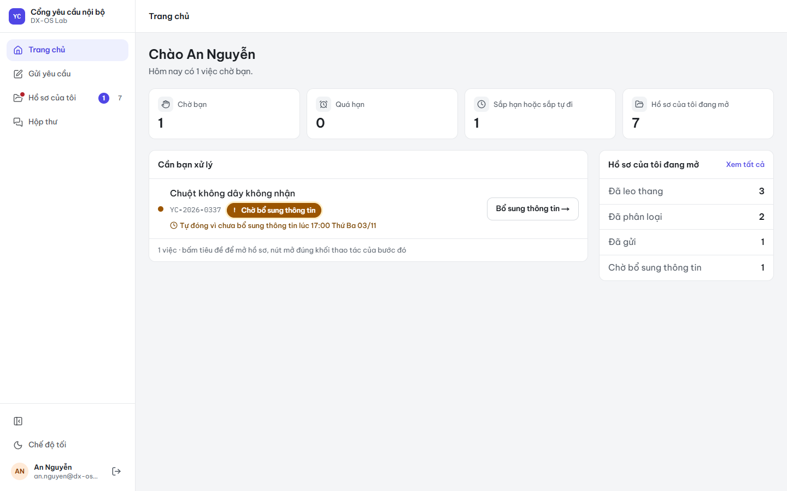
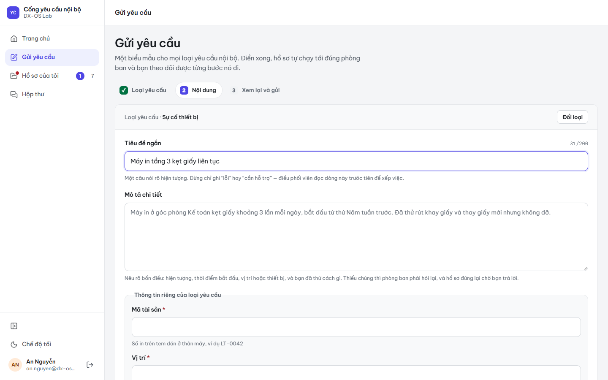
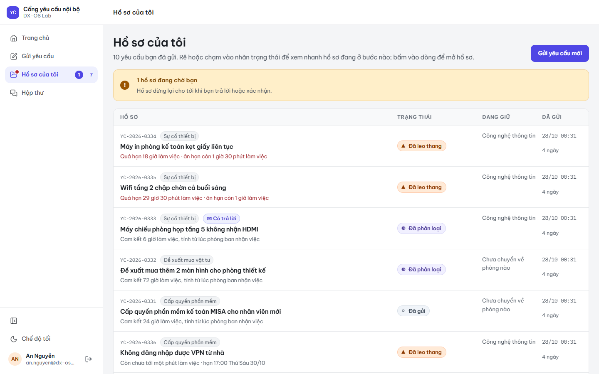

Mọi nhân viên đều là người gửi. Ví dụ dùng tài khoản `an.nguyen`.

## Trang chủ

Mở cổng là thấy **việc đang chờ bạn** — hồ sơ cần bạn trả lời hay xác nhận — kèm nút mang đúng
tên bước. Cột phải tóm tắt hồ sơ bạn đang mở theo trạng thái.

## Gửi yêu cầu

Mục **Gửi yêu cầu** (`/yeu-cau/moi`) là biểu mẫu ba bước:

1. **Loại yêu cầu** — chọn một loại; mỗi loại ghi sẵn thời hạn cam kết. Chưa rõ thuộc loại nào thì
   chọn *Chưa rõ*, điều phối viên phân loại giúp
2. **Nội dung** — tiêu đề, mô tả, các **trường riêng của loại** (ví dụ Sự cố thiết bị có *Mã tài
   sản*, *Vị trí*, *Mức ảnh hưởng*; dấu `*` là bắt buộc) và tệp đính kèm
3. **Xem lại và gửi**

Bạn **không đặt mức ưu tiên** — điều phối viên đặt sau khi phân loại, để mức ưu tiên còn ý nghĩa.

## Theo dõi hồ sơ

**Hồ sơ của tôi** (`/yeu-cau`) liệt kê mọi hồ sơ đã gửi. Rê chuột hay chạm vào nhãn trạng thái để
xem hồ sơ đang ở bước nào trên đường đi. Hồ sơ đang chờ bạn được đánh dấu *Đang chờ bạn*.

Mở một hồ sơ để thấy thao tác làm được lúc này, phần **Trao đổi** với nhân viên, tệp đính kèm, và
**dòng thời gian** — mọi bước, ai bấm, lúc nào.

Mỗi trạng thái có một dấu hiệu riêng trước nhãn (`○ ◐ ◌ ● ! ✓ ✕ ▲ ■ –`), nên in bằng **Ctrl+P** ra
giấy đen trắng — hay với người không phân biệt được màu — vẫn đọc được hồ sơ đang ở đâu.

## Những việc bạn làm được

| Khi hồ sơ ở | Bạn làm được |
|---|---|
| *Đã gửi* | **Sửa nội dung**, **Hủy yêu cầu** |
| *Đã phân loại* | **Sửa nội dung** (hồ sơ về *Đã gửi* để phân loại lại), **Hủy yêu cầu** |
| *Chờ phòng ban xác duyệt* | **Hủy yêu cầu** |
| *Chờ bổ sung thông tin* | **Bổ sung thông tin** — hồ sơ quay về đúng chỗ đã hỏi; **Hủy yêu cầu** |
| *Hoàn tất* | **Xác nhận đạt**, hoặc **Mở lại, chưa đạt** kèm lý do |
| *Đã đóng* | **Mở lại sau khi đóng** — trong 7 ngày làm việc, tối đa 2 lần mỗi hồ sơ |

Khi phòng ban đã bắt tay vào việc, nút Hủy không còn — đó là chủ ý. Hết lượt mở lại hay quá hạn
thì bấm **Tạo hồ sơ mới từ hồ sơ này**: biểu mẫu chép sẵn nội dung và hai hồ sơ liên kết nhau.

## Hạn tự đi

Hồ sơ không chờ mãi:

- Được hỏi thêm mà không trả lời trong **40 giờ làm việc** thì hồ sơ tự đóng; màn hình nhắc trước
- Hồ sơ *Hoàn tất* mà không xác nhận trong **24 giờ làm việc** thì tự đóng

Xem [Hạn xử lý và tự động](../han-xu-ly/).
