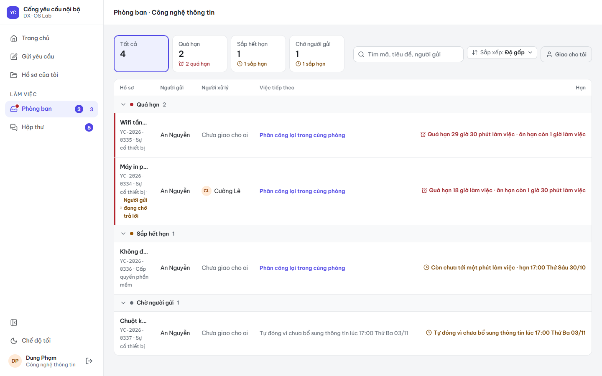

Cả phòng nhìn chung một hàng đợi; nút của mỗi người khác nhau theo vai. Ví dụ dùng `dung.pham`
(trưởng phòng Công nghệ thông tin) và `cuong.le` (người xử lý cùng phòng).

## Hàng đợi phòng ban

Mục **Phòng ban** (`/phong-ban`) chia hồ sơ theo độ gấp: quá hạn, sắp hết hạn, trong hạn, chờ phòng
xác duyệt, chờ người gửi. Dải số trên đầu bấm để lọc; mỗi ô có biểu tượng kèm chữ, không chỉ bằng
màu. Nút **Giao cho tôi** chỉ hiện việc của riêng bạn.

## Trưởng phòng

| Khi hồ sơ ở | Bạn làm được |
|---|---|
| *Chờ phòng ban xác duyệt* | **Xác duyệt và giao xử lý** — chọn người trong phòng (tùy chọn); **Từ chối vì sai chuyên môn** kèm lý do; **Yêu cầu bổ sung thông tin** |
| *Đã leo thang* | **Phân công lại trong cùng phòng**; **Gia hạn xử lý** kèm lý do, tới khi hết lượt |

Ô chọn người đọc từ danh bạ Keycloak: chỉ người của đúng phòng và nhận được việc, không có tài
khoản đã khóa. Danh bạ không trả lời thì vẫn nhận được hồ sơ, chỉ chưa giao được người.

**Đã nhận là không trả về**: sau khi xác duyệt, hồ sơ không quay lại điều phối được nữa — vấn đề
phát sinh do chính phòng xử lý.

## Người xử lý

| Khi hồ sơ ở *Đang xử lý* | |
|---|---|
| **Nhận việc về mình** | Khi hồ sơ chưa giao ai |
| **Yêu cầu bổ sung thông tin** | Hỏi người gửi; đồng hồ hạn của phòng dừng trong lúc chờ |
| **Hoàn thành xử lý** | Hồ sơ sang *Hoàn tất*, chờ người gửi xác nhận |

Người cùng phòng hoàn thành được hồ sơ đã giao người khác; dòng thời gian ghi đúng người bấm.

## Hạn và leo thang

Đồng hồ hạn bắt đầu chạy khi phòng **xác duyệt** hồ sơ. Quá hạn thì hệ thống **tự leo thang** lên
trưởng phòng; người được phân công lại có thêm **ân hạn** trước khi bị leo thang lần nữa. Xem
[Hạn xử lý và tự động](../han-xu-ly/).

Trang hồ sơ hiện email và số điện thoại của người gửi để liên hệ nhanh.
