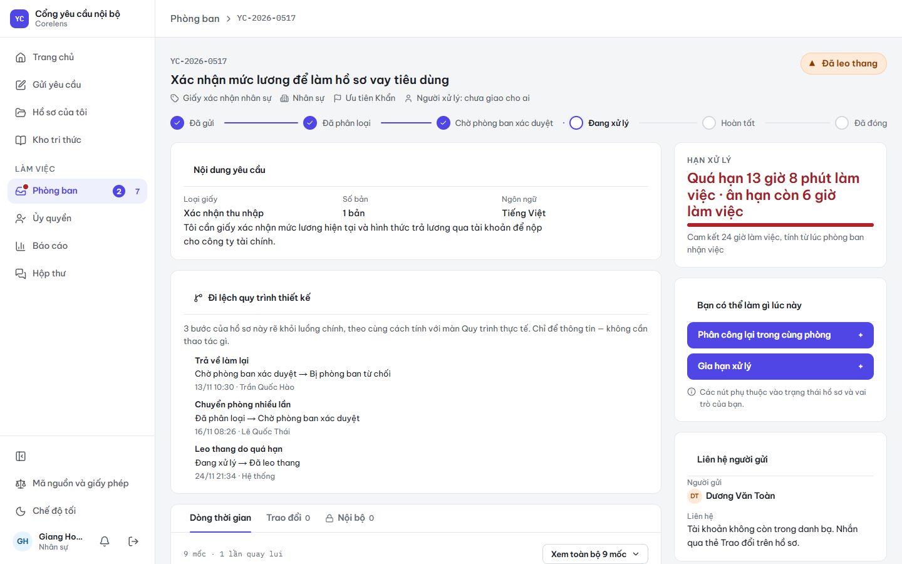

Cả phòng nhìn chung một hàng đợi; nút của mỗi người khác nhau theo vai. Ví dụ dùng `dung.pham`
(trưởng phòng Công nghệ thông tin) và `cuong.le` (người xử lý cùng phòng).

## Hàng đợi phòng ban

Mục **Phòng ban** (`/phong-ban`) chia hồ sơ theo độ gấp: quá hạn, sắp hết hạn, trong hạn, chờ phòng
xác duyệt, chờ người gửi. Dải số trên đầu bấm để lọc; mỗi ô có biểu tượng kèm chữ, không chỉ bằng
màu. Nút **Giao cho tôi** chỉ hiện việc của riêng bạn. Tìm, lọc theo loại và mức ưu tiên, chuyển
trang giống hàng đợi điều phối; số trên dải luôn đếm cả hàng đợi, không chỉ trang đang xem. Bấm
một dòng mở ngăn xem nhanh bên phải, dùng phím như ở hàng đợi điều phối. Trên trang hồ sơ đầy đủ,
khung **Bạn có thể làm gì lúc này** đứng đầu: nút thao tác xếp một hàng, các ô mở ngay dưới — ô
người xử lý có gợi ý kèm lý do và nguồn; cột bên phải có hạn xử lý và thông tin hồ sơ. Đổi ý thì bấm
**Hủy thao tác**.

### Dạng bảng Kanban

Nút **Dạng bảng** trên hàng đợi mở `/phong-ban/bang`: cùng các hồ sơ đó, chia **cột theo trạng thái** —
chờ phòng xác duyệt, đang xử lý, chờ bổ sung thông tin… — để nhìn một lần thấy việc của phòng đang dồn ở bước
nào. Tên và thứ tự cột lấy từ quy trình đang chạy, đầu cột ghi số hồ sơ; chỉ hiện cột có hồ sơ. Mỗi thẻ có
mã, tiêu đề, loại, người xử lý và câu hạn — viền trái đỏ là quá hạn, vàng là sắp hết hạn. **Giao cho tôi**
lọc như ở hàng đợi; **Dạng danh sách** quay lại hàng đợi.

Bảng chỉ để nhìn: bấm một thẻ mở trang hồ sơ, mọi bước chuyển vẫn làm bằng các nút trên trang đó — không kéo
thả thẻ sang cột khác, vì bước chuyển có thể cần ghi chú, chọn người hay qua ràng buộc. Bảng đọc tối đa 200
hồ sơ; phòng có nhiều hơn thì một dòng nhắc xem đủ ở dạng danh sách.

## Trưởng phòng

| Khi hồ sơ ở | Bạn làm được |
|---|---|
| *Chờ phòng ban xác duyệt* | **Xác duyệt và giao xử lý** — chọn người trong phòng (tùy chọn); **Từ chối vì sai chuyên môn** kèm lý do; **Yêu cầu bổ sung thông tin** |
| *Đã leo thang* | **Phân công lại trong cùng phòng**; **Gia hạn xử lý** kèm lý do, tới khi hết lượt |

Ô chọn người đọc từ danh bạ Keycloak: chỉ người của đúng phòng và nhận được việc, không có tài
khoản đã khóa. Danh bạ không trả lời thì vẫn nhận được hồ sơ, chỉ chưa giao được người.

**Gợi ý người xử lý.** Trên ô chọn có thẻ *Gợi ý* nêu một người trong số đó kèm lý do, ví dụ *"Đang
giữ 2 việc, đã xử lý 14 hồ sơ cùng loại."* — người ít việc đang giữ và đã làm nhiều hồ sơ cùng loại
được ưu tiên; quản trị viên chỉnh mức coi trọng hai điều đó (`DXLAB_ASSIGNEE_SUGGEST_*`, trang
[Cấu hình](../../cai-dat/cau-hinh/)). Hồ sơ chưa giao ai thì ô điền sẵn người được gợi ý. Gợi ý tính
khi hồ sơ về phòng và tính lại mỗi lần bạn mở hồ sơ, nên theo kịp việc vừa giao cho người khác. Giữ hay
chọn người khác đều được — lựa chọn của bạn được ghi vào nhật ký, và tỷ lệ chọn khác gợi ý hiện trên
bảng điều khiển. Gợi ý không cần mô hình ngôn ngữ; danh bạ không trả lời thì không có gợi ý.

**Đã nhận là không trả về**: sau khi xác duyệt, hồ sơ không quay lại điều phối được nữa — vấn đề
phát sinh do chính phòng xử lý.

**Báo cáo** trên thanh bên mở bảng điều khiển của phòng bạn: hồ sơ đang mở theo trạng thái, thời gian
xử lý trung vị theo loại yêu cầu so với ngưỡng hạn, tỷ lệ trễ hạn, số yêu cầu mỗi tuần, và hàng **mức
hài lòng**: điểm trung bình, tỷ lệ hồ sơ được chấm, phân bố điểm 1–5 (lần chấm mới nhất của mỗi hồ sơ;
hồ sơ tự đóng không tính). Chỉ có số của phòng mình — dòng *Phạm vi số liệu* dưới tiêu đề ghi rõ.

**Đánh giá của người gửi.** Người gửi chấm 1–5 sao kèm nhận xét khi xác nhận đạt, không bắt buộc. Có
điểm thì trang hồ sơ có khối *Đánh giá của người gửi* — số sao, nhận xét, thời điểm; hồ sơ mở lại rồi
xác nhận lần nữa thì liệt kê đủ, mới nhất trước. Khối chỉ để đọc; chưa ai chấm thì không có khối.

## Người xử lý

| Khi hồ sơ ở *Đang xử lý* | |
|---|---|
| **Nhận việc về mình** | Khi hồ sơ chưa giao ai |
| **Yêu cầu bổ sung thông tin** | Hỏi người gửi; đồng hồ hạn của phòng dừng trong lúc chờ |
| **Hoàn thành xử lý** | Hồ sơ sang *Hoàn tất*, chờ người gửi xác nhận |

Người cùng phòng hoàn thành được hồ sơ đã giao người khác; dòng thời gian ghi đúng người bấm. Bảng xác nhận
của **Hoàn thành xử lý** có ô **Cách giải quyết**, không bắt buộc: ghi ngắn đã làm gì để xong việc. Dòng này
nằm trong dòng thời gian, và khi người gửi xác nhận đạt, nó là cách giải quyết mà gợi ý hồ sơ tương tự hiện cho
người gặp vấn đề giống vậy về sau.

## Hồ sơ đi lệch quy trình

Trang hồ sơ của phòng có thêm khối **Đi lệch quy trình thiết kế** khi hồ sơ đã rẽ khỏi luồng chính:
mỗi dòng là một bước lệch — loại lệch (*Trả về làm lại*, *Leo thang do quá hạn*, *Tự chuyển khi hết hạn
chờ*, *Mở lại sau khi kết thúc*, *Chuyển phòng nhiều lần*), trạng thái đi và đến, lúc xảy ra và người
thực hiện. Cách tính đúng như năm nhánh lệch của màn [Quy trình thực tế](../quy-trinh-thuc-te/), nên một
hồ sơ có bước lệch ở đây thì cũng nằm trong nhánh đó trên màn kia.

Khối **chỉ để thông tin**: không có nút, không đổi gì trên hồ sơ, không cần bạn làm gì. Hồ sơ đi đúng
luồng thì không có khối nào; dịch vụ khai phá quy trình tắt hay chưa trả lời thì trang y như bình thường.
Người gửi không thấy khối này. Trưởng phòng, người xử lý và điều phối viên thấy trên mọi hồ sơ mình
mở được.

## Hạn và leo thang

Đồng hồ hạn bắt đầu chạy khi phòng **xác duyệt** hồ sơ. Quá hạn thì hệ thống **tự leo thang** lên
trưởng phòng; người được phân công lại có thêm **ân hạn** trước khi bị leo thang lần nữa. Xem
[Hạn xử lý và tự động](../han-xu-ly/).

Trang hồ sơ hiện email và số điện thoại của người gửi để liên hệ nhanh.
