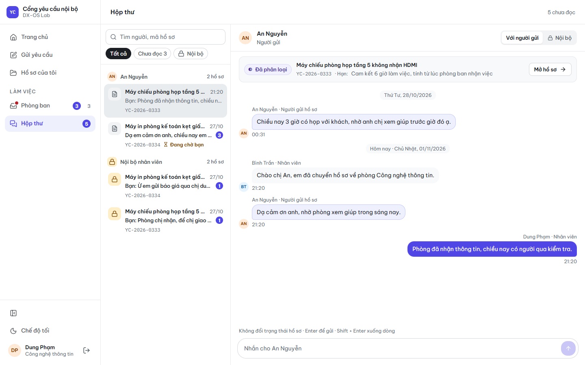

Mỗi hồ sơ có phần **Trao đổi** để hỏi đáp thay cho gọi điện — câu hỏi và câu trả lời nằm lại trên hồ
sơ, người được giao sau vẫn đọc được.

## Ba loại lời nhắn

| Loại | Ai dùng | Ghi chú |
|---|---|---|
| **Lời nhắn** | Người gửi và mọi nhân viên đang giữ hồ sơ | Hai chiều |
| **Hỏi tiến độ** | Chỉ người gửi, khi hồ sơ đang ở phòng ban | Hỏi lại được khi phòng đã trả lời, hoặc đã quá 4 giờ |
| **Nhắn nội bộ** | Chỉ nhân viên | Người gửi hồ sơ **không thấy**, kể cả khi người đó cũng là nhân viên |

Hồ sơ đã kết thúc thì phần trao đổi chỉ đọc.

:::note[Lời nhắn khác "Yêu cầu bổ sung thông tin" thế nào]
Lời nhắn **không đổi trạng thái** hồ sơ và **không dừng đồng hồ hạn**, không bắt ai phải trả lời.
*Yêu cầu bổ sung thông tin* là một bước của quy trình: hồ sơ sang *Chờ bổ sung thông tin*, đồng hồ của
phòng dừng, người gửi bắt buộc trả lời. Ranh giới này ghi ở
[ADR-0005](https://github.com/AlaVox-lab/dx-os-lab/blob/main/docs/adr/0005-ranh-gioi-may-trang-thai.md).
:::

## Hộp thư

Mục **Hộp thư** (`/hop-thu`) gom mọi cuộc trao đổi của bạn về một chỗ, giống ứng dụng nhắn tin.
**Mỗi cuộc gắn với đúng một hồ sơ**; nhân viên có thêm kênh *Nội bộ* của từng hồ sơ. Bạn chỉ thấy hồ
sơ mình đang giữ — điều phối viên thấy hàng đợi điều phối cộng hồ sơ mình đã nhắn.

Bên phải là tin của chính bạn; tin của người khác nằm bên trái, ghi tên kèm *Người gửi hồ sơ* hay
*Nhân viên*. Hộp thư tự cập nhật vài giây một lần, và số tin chưa đọc hiện trên thanh bên.

