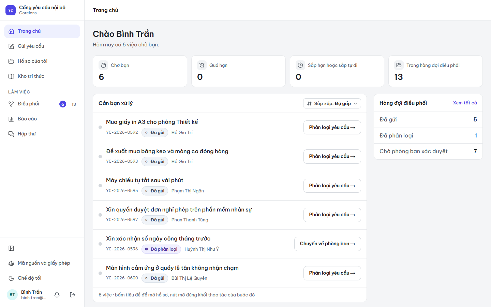

import LoiVao from "../../components/LoiVao.astro";

Corelens là cổng vận hành yêu cầu nội bộ nguồn mở cho doanh nghiệp. Nhân viên gửi báo hỏng thiết bị, xin cấp
quyền phần mềm, xin giấy xác nhận hay đề xuất mua sắm; điều phối viên chọn phòng xử lý cho từng hồ sơ; phòng
ban nhận, giao người và báo xong. Quy trình mẫu có 11 trạng thái và 32 bước, khai trong dữ liệu, nên doanh
nghiệp đổi quy trình mà không sửa mã. Bên dưới cổng là một nền tảng lõi chỉ có API, `/core/v1`, để ứng dụng
khác dùng lại.

Cả cụm tám dịch vụ dựng bằng một lệnh Docker Compose. Mã nguồn và bản phát hành ở
[GitHub](https://github.com/AlaVox-lab/corelens).

## Bắt đầu

<LoiVao
  muc={[
    { nhan: "Giới thiệu", href: "bat-dau/gioi-thieu/", moTa: "Vấn đề Corelens giải quyết, bốn vai trên một hồ sơ, kiến trúc H-P-D-I" },
    { nhan: "Bắt đầu nhanh", href: "bat-dau/bat-dau-nhanh/", moTa: "Dựng cụm bằng bốn lệnh, rồi đi một hồ sơ từ lúc gửi tới lúc đóng qua bốn tài khoản" },
    { nhan: "Tài khoản mẫu", href: "huong-dan/tai-khoan-mau/", moTa: "Mười ba tài khoản của realm mẫu, vai trò và phòng ban của từng người" },
  ]}
/>

## Cài đặt và vận hành

<LoiVao
  muc={[
    { nhan: "Cài đặt", href: "cai-dat/cai-dat/", moTa: "Yêu cầu máy, cài từ bản phát hành hay từ kho mã, kiểm cụm, việc phải làm trước khi dùng thật" },
    { nhan: "Cấu hình", href: "cai-dat/cau-hinh/", moTa: "Từng biến trong infra/.env: cổng, mật khẩu, giới hạn tệp, bộ quét hạn" },
    { nhan: "Sự cố thường gặp", href: "cai-dat/su-co/", moTa: "Dấu hiệu và cách xử lý lỗi hay gặp khi dựng và chạy cụm" },
    { nhan: "Nâng cấp", href: "cai-dat/nang-cap/", moTa: "Lên bản mới giữ nguyên hồ sơ và nhật ký, cách tự kiểm không mất dữ liệu" },
    { nhan: "Sao lưu và khôi phục", href: "cai-dat/sao-luu/", moTa: "Sao lưu tay cơ sở dữ liệu và kho tệp trong một lần, khôi phục có đối soát" },
    { nhan: "Mô hình ngôn ngữ", href: "cai-dat/mo-hinh-ngon-ngu/", moTa: "Bật gợi ý phân loại và hồ sơ tương tự bằng mô hình chạy trên máy, kèm kết quả đo" },
    { nhan: "Thông báo thư và quét mã độc", href: "cai-dat/thu-va-quet-tep/", moTa: "Thư khi có việc chờ, hộp thư thử Mailpit, quét tệp đính kèm bằng ClamAV" },
    { nhan: "Kho tri thức", href: "cai-dat/kho-tri-thuc/", moTa: "Wiki.js đăng nhập một lần, quyền theo vai, bài hướng dẫn hiện lúc soạn yêu cầu" },
    { nhan: "Xác thực hai lớp", href: "cai-dat/xac-thuc-hai-lop/", moTa: "Bật mã dùng một lần khi đăng nhập cho mọi tài khoản, chỉ bằng cấu hình Keycloak" },
  ]}
/>

## Dùng hằng ngày theo vai

<LoiVao
  muc={[
    { nhan: "Người gửi", href: "huong-dan/nguoi-gui/", moTa: "Gửi yêu cầu, theo dõi hồ sơ, trả lời khi được hỏi thêm, xác nhận đạt hay mở lại" },
    { nhan: "Điều phối viên", href: "huong-dan/dieu-phoi-vien/", moTa: "Phân loại, đặt mức ưu tiên, chọn phòng cho từng hồ sơ hay cả lô" },
    { nhan: "Trưởng phòng và người xử lý", href: "huong-dan/phong-ban/", moTa: "Nhận hồ sơ về phòng, giao người, xử lý, báo hoàn thành, phân công lại khi leo thang" },
    { nhan: "Trao đổi và hộp thư", href: "huong-dan/trao-doi/", moTa: "Lời nhắn trên hồ sơ, hỏi tiến độ, trao đổi nội bộ, hộp thư chung" },
    { nhan: "Ủy quyền khi vắng mặt", href: "huong-dan/uy-quyen/", moTa: "Nhờ người cùng phòng làm thay trong những ngày vắng" },
    { nhan: "Hạn xử lý và tự động", href: "huong-dan/han-xu-ly/", moTa: "Hạn đếm theo giờ làm việc, gia hạn, leo thang, các bước hệ thống tự đi" },
    { nhan: "Quy trình thực tế", href: "huong-dan/quy-trinh-thuc-te/", moTa: "Sơ đồ quy trình vẽ lại từ nhật ký sự kiện: điểm nghẽn, nhánh lệch, đường đi phổ biến" },
  ]}
/>

## Quản trị và tùy biến

<LoiVao
  muc={[
    { nhan: "Màn Cấu hình quy trình", href: "quan-tri/man-cau-hinh/", moTa: "Sửa hạn, mức ưu tiên, loại yêu cầu, phòng ban ngay trên cổng, không dựng lại cụm" },
    { nhan: "Tùy biến quy trình", href: "quan-tri/tuy-bien-quy-trinh/", moTa: "Đổi trạng thái, bước đi, vai trò và ràng buộc bằng dữ liệu khởi tạo" },
    { nhan: "Danh mục và các con số", href: "quan-tri/danh-muc-va-con-so/", moTa: "Phòng ban, loại yêu cầu, mức ưu tiên, lịch làm việc và cơ sở của từng con số mẫu" },
    { nhan: "Màn Hệ thống và vận hành", href: "quan-tri/he-thong/", moTa: "Tình trạng cụm, bộ quét hạn, xuất nhật ký, webhook, nhật ký truy cập, báo cáo" },
  ]}
/>

## Tích hợp qua API lõi

<LoiVao
  muc={[
    { nhan: "API", href: "tham-khao/api/", moTa: "API /core/v1, token của tài khoản dịch vụ, quy trình dạng BPMN, gọi lặp an toàn bằng Idempotency-Key" },
    { nhan: "Từ điển dữ liệu", href: "tham-khao/tu-dien-du-lieu/", moTa: "Mỗi bảng của dịch vụ ứng dụng: nghĩa, cột, kiểu, khóa" },
    { nhan: "Phả hệ dữ liệu", href: "tham-khao/pha-he-du-lieu/", moTa: "Mỗi biểu đồ lấy số từ view và bảng nguồn nào" },
  ]}
/>

## Phát triển

<LoiVao
  muc={[
    { nhan: "Kiến trúc", href: "phat-trien/kien-truc/", moTa: "Hai tầng lõi và ứng dụng minh họa, các dịch vụ trong cụm, engine máy trạng thái" },
    { nhan: "Đóng góp", href: "phat-trien/dong-gop/", moTa: "Nhánh, commit, kiểm thử, tích hợp liên tục, cách dựng trang tài liệu này" },
    { nhan: "Kiểm thử giao diện", href: "phat-trien/kiem-thu-giao-dien/", moTa: "Kịch bản Playwright qua đăng nhập thật, bốn cấu hình hiển thị" },
    { nhan: "Công cụ kiểm chứng", href: "phat-trien/kiem-chung/", moTa: "Cụm thử cách ly, dò đăng nhập thật, hồ sơ thử theo trạng thái, phép thử đột biến" },
    { nhan: "Phát hành và giấy phép", href: "tham-khao/phat-hanh/", moTa: "Các bản phát hành, nhật ký thay đổi, giấy phép MIT và AGPL theo thư mục" },
  ]}
/>
