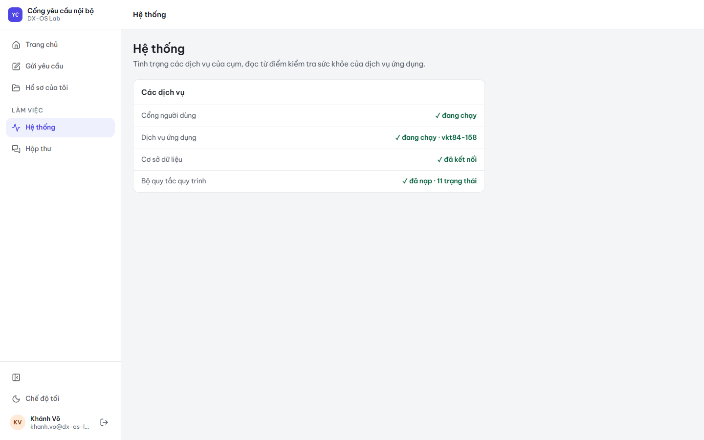

## Màn Hệ thống

Quản trị viên (tài khoản mẫu `khanh.vo`) mở **Hệ thống** (`/he-thong`) để xem tình trạng cụm, đọc
từ điểm kiểm tra sức khỏe của dịch vụ ứng dụng: cổng người dùng, dịch vụ ứng dụng và phiên bản, cơ sở
dữ liệu, bộ quy tắc quy trình đã nạp và có bao nhiêu trạng thái. Người dùng khác không thấy
mục này — trang chủ của họ chỉ có việc cần làm, không có chữ kỹ thuật.



Quản trị viên **không đứng trong quy trình**: không đi bước nào trên hồ sơ, không mở hồ sơ ở buồng lái
nào.

## Kiểm sức khỏe không cần đăng nhập

`http://localhost:8000/health` trả tình trạng dịch vụ ứng dụng — dùng được cho công cụ giám sát.

## Bộ quét hạn

Dịch vụ ứng dụng chạy một bộ quét nền, mặc định mỗi 60 giây: leo thang hồ sơ quá hạn và đi các bước
tự động khi hồ sơ nằm im quá hạn chờ. Bật tắt và chu kỳ ở `SLA_SCAN_ENABLED`,
`SLA_SCAN_INTERVAL_SECONDS` trong `.env`. Quản trị viên chạy được một lượt ngay bằng `POST /sla/scan`.

**Thử leo thang mà không phải chờ hết hạn thật** (chỉ trên cụm thử): đẩy một hồ sơ đang xử lý sang quá
hạn — lùi cả mốc vào trạng thái, không thì hồ sơ còn nằm trong ân hạn — rồi chờ một lượt quét:

```bash
docker exec dxlab-postgres psql -U dxlab -d dxlab -c "UPDATE requests SET sla_running_seconds = 999999, sla_segment_since = now() - interval '1 day' WHERE id = <số hồ sơ>"
```

## Người dùng và phòng ban

Người dùng, vai trò và phòng ban quản lý ở Keycloak (`http://localhost:8080`, tài khoản quản trị
trong `.env`):

- **Vai trò** là vai trò của realm: `requester`, `classifier`, `approver`, `handler`, `administrator`
- **Phòng ban** là nhóm dưới đường dẫn `/phong-ban/` (đổi bằng `KEYCLOAK_DEPARTMENT_GROUP_PREFIX`)
- Khóa tài khoản người nghỉ việc thì họ không đăng nhập được và không còn trong danh sách nhận việc
  (tài khoản mẫu `tuan.ngo`)
- Gán vai qua **nhóm** cũng được, như doanh nghiệp thật hay làm — tài khoản mẫu `lan.vu` nhận vai người
  xử lý qua nhóm `/nhom-vai-tro/nguoi-xu-ly`
- Client `dx-directory` không dùng để đăng nhập: đó là tài khoản dịch vụ chỉ đọc, để dịch vụ ứng dụng
  tra tên người trong phòng cho ô chọn người xử lý

Thêm phòng ban mới phải thêm cả nhóm trong Keycloak lẫn dòng trong bảng `departments` — xem
[Danh mục và các con số](../danh-muc-va-con-so/).

## Xuất nhật ký sự kiện

Khối **Xuất nhật ký sự kiện** trên màn Hệ thống tải nhật ký dạng CSV hoặc JSON, chọn khoảng ngày (theo
UTC) hay bỏ trống để lấy hết. Mỗi dòng một sự kiện: `case_id`, `activity`, `timestamp` (UTC),
`actor`, `from_state`, `to_state`, cùng loại yêu cầu, phòng ban, mức ưu tiên và bộ quy tắc của hồ
sơ; mỗi hồ sơ mở đầu bằng sự kiện `create-case` lúc tạo. Người thao tác chỉ ghi bằng mã định danh,
không có tên và ghi chú. Tệp CSV mở thẳng bằng bảng tính, chữ có dấu hiện đúng. Công cụ khác gọi
`GET /analytics/event-log?format=csv&from=2026-11-01&to=2026-11-30` bằng token của quản trị viên.

## Báo cáo

Apache Superset (`http://localhost:8088`) có sẵn dashboard **Vận hành yêu cầu** ngay khi dựng cụm:
tồn đọng theo phòng ban, thời gian xử lý trung vị theo loại yêu cầu, tỷ lệ vi phạm hạn theo phòng
ban, phân bố loại yêu cầu theo tuần. Superset đọc dữ liệu nghiệp vụ bằng tài khoản chỉ đọc; dashboard
nạp từ tệp trong `infra/superset/bang-dieu-khien/` mỗi lần khởi động. Đăng nhập Superset bằng tài
khoản quản trị trong `.env` (`SUPERSET_ADMIN_USER`) để sửa; sửa xong phải xuất lại ra thư mục đó —
cách làm ở `docs/ARCHITECTURE.md` mục 6.3. Nhúng dashboard vào cổng cho trưởng phòng và điều phối
viên: #305.

**Dữ liệu trình diễn.** Cụm mới dựng chỉ có vài hồ sơ, biểu đồ gần như trống. Trên cụm thử hay cụm
trình diễn, nạp vài trăm hồ sơ giả trải ba tháng, đi đúng bộ quy tắc đang bật:

```bash
python scripts/nap_du_lieu_trinh_dien.py --xac-nhan
```

Chạy ở gốc kho mã khi cụm đang chạy, chỉ cần Python 3.10 trở lên. Hồ sơ mẫu mang tiền tố `[Mẫu]` và
**không gỡ ra được** — nhật ký sự kiện chỉ ghi thêm — nên muốn sạch lại thì `down -v`. Lệnh dừng khi
cụm đã có hồ sơ thật; trên cụm thử có vài hồ sơ tạo tay thì thêm `--cho-tron`. Đổi số hồ sơ và số
ngày bằng `--so-ho-so`, `--so-ngay`.
