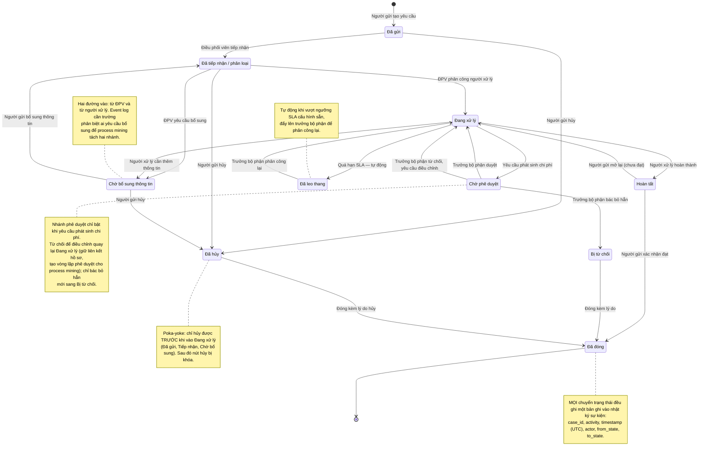

# Luồng nghiệp vụ — Cổng vận hành yêu cầu nội bộ

Sơ đồ trạng thái mô tả vòng đời một yêu cầu nội bộ, từ lúc người gửi tạo yêu cầu
tới khi đóng. Đây là bản thiết kế tham chiếu cho máy trạng thái của không gian `P`
(Quy trình). Toàn bộ trạng thái, quy tắc chuyển và ngưỡng SLA về sau phải nằm trong
cấu hình hoặc dữ liệu, không mã cứng trong mã nguồn.

## Sơ đồ trạng thái

## Diễn giải

### Các trạng thái

| Trạng thái | Ý nghĩa |
|---|---|
| Đã gửi | Người gửi vừa tạo yêu cầu, chờ điều phối viên tiếp nhận |
| Đã tiếp nhận / phân loại | Điều phối viên đã nhận, phân loại và chuẩn bị phân công |
| Chờ bổ sung thông tin | Yêu cầu thiếu thông tin, chờ người gửi bổ sung |
| Đang xử lý | Người xử lý đang thực hiện |
| Chờ phê duyệt | Yêu cầu phát sinh chi phí, chờ trưởng bộ phận quyết định |
| Đã leo thang | Quá hạn SLA, đã đẩy lên trưởng bộ phận |
| Bị từ chối | Trưởng bộ phận bác bỏ hẳn |
| Đã hủy | Người gửi rút yêu cầu (chỉ khi chưa vào Đang xử lý) |
| Hoàn tất | Người xử lý đã hoàn thành, chờ người gửi xác nhận |
| Đã đóng | Trạng thái kết thúc |

### Bốn vai trò

- **Người gửi** — tạo yêu cầu, bổ sung thông tin, hủy (khi được phép), xác nhận hoặc mở lại.
- **Điều phối viên** — tiếp nhận, phân loại, yêu cầu bổ sung, phân công người xử lý.
- **Người xử lý** — thực hiện yêu cầu, yêu cầu thêm thông tin khi cần, đánh dấu hoàn thành.
- **Trưởng bộ phận** — phê duyệt hoặc từ chối khi phát sinh chi phí, phân công lại khi leo thang.

### Các nhánh đáng chú ý

- **Nhánh phê duyệt** chỉ kích hoạt khi yêu cầu phát sinh chi phí. Từ chối chia hai loại:
  *từ chối để điều chỉnh* (quay lại Đang xử lý, giữ liên kết hồ sơ và tạo vòng lặp phê
  duyệt cho khai phá quy trình) và *bác bỏ hẳn* (sang Bị từ chối rồi Đã đóng).
- **Nhánh chờ bổ sung** vào từ hai phía — điều phối viên hoặc người xử lý. Nhật ký sự kiện
  cần một trường phân biệt ai yêu cầu, để khai phá quy trình tách được hai nhánh này.
- **Ràng buộc Poka-yoke khi hủy**: chỉ hủy được trước khi vào Đang xử lý (Đã gửi, Đã tiếp
  nhận, Chờ bổ sung). Sau đó nút hủy bị khóa để tránh hủy nhầm yêu cầu đang được xử lý.
- **Tự leo thang theo SLA**: khi quá ngưỡng thời gian cấu hình sẵn, yêu cầu tự chuyển sang
  Đã leo thang và đẩy lên trưởng bộ phận để phân công lại.

### Nhật ký sự kiện

Mọi lần chuyển trạng thái đều ghi một bản ghi vào nhật ký sự kiện với lược đồ
`case_id`, `activity`, `timestamp` (UTC), `actor`, `from_state`, `to_state`. Đây là nguồn
dữ liệu cho khai phá quy trình ở không gian `I` — gỡ nó ra thì sản phẩm tụt xuống mức
helpdesk thông thường.
