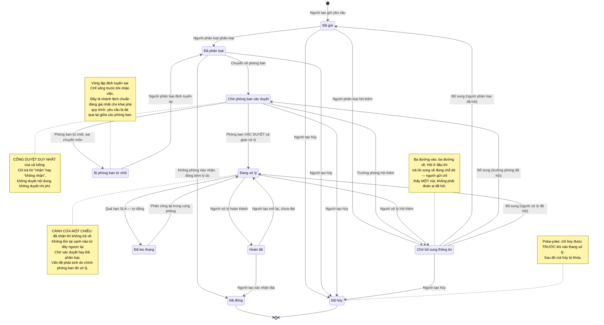

# Luồng nghiệp vụ — Cổng vận hành yêu cầu nội bộ

Sơ đồ trạng thái mô tả vòng đời một yêu cầu nội bộ, từ lúc người tạo gửi yêu cầu tới khi
đóng. Đây là bản thiết kế tham chiếu cho máy trạng thái của không gian `P`.

**Toàn bộ trạng thái, quy tắc chuyển, vai trò, phòng ban và ngưỡng SLA phải nằm trong bảng
dữ liệu, không mã cứng trong mã nguồn.** Xem `ARCHITECTURE.md` mục 5.

> **Cập nhật 10/09/2026** theo buổi trao đổi với giảng viên hướng dẫn: năm vai trò thay cho
> bốn, thêm chặng định tuyến phòng ban, và bỏ cổng phê duyệt chi phí. Xem mục 7.

---

## 1. Sơ đồ trạng thái

---

## 2. Mười trạng thái

Cột **Định danh** là giá trị thật lưu trong bảng `states` và trong hai trường `from_state`,
`to_state` của nhật ký sự kiện. Dùng tiếng Anh vì mã nguồn so sánh với chúng; cột **Nhãn**
là chuỗi hiển thị cho người dùng. Theo quy ước ở `ARCHITECTURE.md` mục 8.3.

| # | Định danh | Nhãn hiển thị | Ý nghĩa | Kết thúc |
|---|---|---|---|---|
| 1 | `submitted` | Đã gửi | Người tạo vừa gửi, chờ phân loại | |
| 2 | `classified` | Đã phân loại | Đã xác định loại yêu cầu và phòng ban phụ trách | |
| 3 | `awaiting-acceptance` | Chờ phòng ban xác duyệt | Đã chuyển về phòng, chờ họ nhận hoặc từ chối | |
| 4 | `in-progress` | Đang xử lý | Phòng ban **đã nhận** và giao người xử lý | |
| 5 | `completed` | Hoàn tất | Người xử lý báo xong, chờ người tạo xác nhận | |
| 6 | `closed` | Đã đóng | | ✅ |
| 7 | `awaiting-info` | Chờ bổ sung thông tin | Hỏi ngược **người tạo**, không phải trả về phòng ban | |
| 8 | `rejected-by-department` | Bị phòng ban từ chối | Sai chuyên môn, cần định tuyến lại | |
| 9 | `escalated` | Đã leo thang | Quá hạn SLA, đẩy lên cấp trên **trong cùng phòng ban** | |
| 10 | `cancelled` | Đã hủy | Người tạo rút yêu cầu | ✅ |

---

## 3. Hai mươi mốt cạnh chuyển trạng thái

Đây là nội dung của bảng `transitions`. Mỗi dòng là một cạnh hợp lệ; **không có dòng nghĩa
là không đi được**.

| Từ | Sang | Hoạt động | Vai trò được phép |
|---|---|---|---|
| `submitted` | `classified` | Phân loại yêu cầu | `classifier` |
| `submitted` | `awaiting-info` | Yêu cầu bổ sung thông tin | `classifier` |
| `submitted` | `cancelled` | Hủy yêu cầu | `requester` |
| `classified` | `awaiting-acceptance` | Chuyển về phòng ban | `classifier` |
| `classified` | `cancelled` | Hủy yêu cầu | `requester` |
| `classified` | `closed` | Đóng hồ sơ, không phòng nào nhận | `classifier` |
| `awaiting-acceptance` | `in-progress` | **Xác duyệt và giao xử lý** | `approver` |
| `awaiting-acceptance` | `awaiting-info` | Yêu cầu bổ sung thông tin | `approver` |
| `awaiting-acceptance` | `rejected-by-department` | Từ chối vì sai chuyên môn | `approver` |
| `awaiting-acceptance` | `cancelled` | Hủy yêu cầu | `requester` |
| `rejected-by-department` | `classified` | Định tuyến lại phòng khác | `classifier` |
| `in-progress` | `awaiting-info` | Yêu cầu bổ sung thông tin | `handler` |
| `in-progress` | `escalated` | Leo thang do quá hạn | **hệ thống** |
| `in-progress` | `completed` | Hoàn thành xử lý | `handler` |
| `escalated` | `in-progress` | Phân công lại trong cùng phòng | `approver` |
| `awaiting-info` | `submitted` | Bổ sung thông tin | `requester` |
| `awaiting-info` | `awaiting-acceptance` | Bổ sung thông tin | `requester` |
| `awaiting-info` | `in-progress` | Bổ sung thông tin | `requester` |
| `awaiting-info` | `cancelled` | Hủy yêu cầu | `requester` |
| `completed` | `closed` | Xác nhận đạt | `requester` |
| `completed` | `in-progress` | Mở lại, chưa đạt | `requester` |

**Chờ bổ sung thông tin quay về đúng chỗ đã hỏi** (#79, navigator chốt ngày 23/09). Ba nơi
hỏi thêm được — điều phối ở *Đã gửi*, trưởng phòng ở *Chờ phòng ban xác duyệt*, người xử lý ở
*Đang xử lý* — và ba cạnh trả lời quay về đúng ba nơi đó. Ràng buộc `return-to-previous-state`
đọc nhật ký sự kiện để biết hồ sơ vào *Chờ bổ sung thông tin* từ đâu, và chỉ cho đi cạnh về
đúng chỗ đó. Người gửi thấy **một** nút *Bổ sung thông tin*, gõ câu trả lời vào ô bắt buộc,
và hồ sơ tự về tay người đã hỏi.

Hệ quả đáng chú ý: hỏi ở *Đã gửi* thì trả lời xong hồ sơ về lại *Đã gửi*, chứ không nhảy sang
*Đã phân loại* như trước. Hồ sơ vì thế phải đi qua đúng cạnh phân loại cùng ràng buộc mức ưu
tiên của nó — lối vòng phát hiện ở #78, nơi hồ sơ vào tận phòng ban mà chưa có mức ưu tiên,
đã đóng.

---

## 4. Năm vai trò

| Định danh | Nhãn hiển thị | Trách nhiệm |
|---|---|---|
| `requester` | Người tạo yêu cầu | Gửi yêu cầu, bổ sung thông tin, hủy khi được phép, xác nhận hoặc mở lại |
| `classifier` | Người phân loại yêu cầu | Phân loại, chọn phòng ban phụ trách, **đặt mức ưu tiên**, hỏi thêm thông tin, định tuyến lại khi bị từ chối |
| `handler` | Người xử lý yêu cầu | Thực hiện công việc, hỏi thêm thông tin khi cần, báo hoàn thành |
| `approver` | Người xét duyệt yêu cầu | Quyết định phòng ban **nhận hay không nhận**, hỏi thêm thông tin trước khi nhận, phân công lại khi leo thang |
| `administrator` | Quản trị viên | **Không đi cạnh nào.** Quản lý phòng ban, loại yêu cầu, ngưỡng SLA, bảng ánh xạ loại → phòng |

Vai trò `classifier` về sau sẽ được tầng `I` hỗ trợ bằng phân loại tự động. Nhưng theo
nguyên tắc bất di dịch ở `ARCHITECTURE.md` mục 2.2, **AI chỉ ghi vào trường gợi ý**, con
người vẫn bấm nút quyết định.

---

## 5. Bốn ràng buộc Poka-yoke

| Ràng buộc | Cách thực thi |
|---|---|
| **Đã nhận là không trả về** | Không tồn tại cạnh nào từ `in-progress` ngược về `awaiting-acceptance` hay `classified`. Không phải *không nên đi*, mà là **không có đường mà đi** |
| **Chỉ hủy trước khi vào xử lý** | Cạnh `cancelled` chỉ xuất phát từ `submitted`, `classified`, `awaiting-acceptance`, `awaiting-info` |
| **Người tạo không tự đặt mức ưu tiên** | Ưu tiên do `classifier` đặt ở cạnh `submitted → classified`, và **chỉ ở cạnh đó** — engine từ chối `priority_code` gửi kèm bất kỳ cạnh nào khác |
| **Leo thang không đổi phòng ban** | Cạnh `escalated → in-progress` giữ nguyên phòng, chỉ đổi người phụ trách |

Mọi ràng buộc cài đặt ở **cả hai phía**: giao diện chặn để trải nghiệm tốt, dịch vụ chặn để
bảo đảm toàn vẹn. Chỉ chặn ở giao diện là không đủ.

**Leo thang lại sau khi phân công lại hay mở lại** (quyết định ngày 23/09, #94). Hồ sơ đã
quá hạn mà được phân công lại, được người gửi mở lại, hay vừa bổ sung thông tin xong thì
người nhận có một **khoảng ân hạn** trước khi bị leo thang lần nữa. Đồng hồ tổng **không**
đặt lại và **không** cấp hạn mới: hồ sơ vẫn được ghi nhận là quá hạn. Hết ân hạn mà vẫn
chưa xong thì leo thang lại. Không có ân hạn thì bộ quét leo thang lại ngay lượt kế tiếp,
và người được giao không có một phút nào để làm.

**Một ràng buộc bổ trợ, thêm ở #78 — cần giảng viên xác nhận:** hồ sơ rời khỏi tay người
phân loại phải có loại yêu cầu. Giữ loại người gửi đã chọn trên biểu mẫu, hoặc người phân
loại đặt mới nếu người gửi bỏ trống. Lý do: loại yêu cầu quyết định ngưỡng SLA, và hồ sơ
không có loại sẽ không bao giờ bị bộ quét đánh dấu quá hạn.

---

## 6. Nhật ký sự kiện

Mọi lần chuyển trạng thái đều ghi một bản ghi với lược đồ `case_id`, `activity`,
`timestamp` (UTC), `actor`, `from_state`, `to_state`. Đây là nguồn dữ liệu cho khai phá
quy trình ở không gian `I`.

Cơ chế bảo đảm nhật ký không bao giờ thiếu bản ghi: **một cửa duy nhất** — mọi lần đổi
trạng thái đi qua đúng một điểm trong mã. Xem `ARCHITECTURE.md` mục 6.1.

**Hai mẫu lệch chuẩn đáng theo dõi nhất**, đều lộ ra từ nhật ký:

- **Vòng lặp định tuyến sai**: `classified → awaiting-acceptance → rejected-by-department →
  classified` lặp nhiều lần. Cho thấy bảng ánh xạ loại yêu cầu sang phòng ban đang sai, hoặc
  ranh giới trách nhiệm giữa các phòng chưa rõ
- **Cạnh đi ngược sau khi đã nhận**: nếu nhật ký xuất hiện cạnh nào từ `in-progress` về phía
  trước, đó là bằng chứng có người lách quy trình bằng đường khác

---

## 7. Chiều dữ liệu cấu hình được

Ngoài trạng thái và quy tắc chuyển, ba nhóm sau cũng là **dữ liệu**, không mã cứng:

| Nhóm | Ví dụ | Ai sửa |
|---|---|---|
| **Phòng ban** | Công nghệ thông tin, Nhân sự, Hành chính, Tài chính kế toán | `administrator` |
| **Loại yêu cầu** | Sự cố thiết bị, cấp quyền phần mềm, giấy xác nhận nhân sự, đề xuất mua vật tư | `administrator` |
| **Ánh xạ loại → phòng ban** | Sự cố thiết bị → Công nghệ thông tin | `administrator` |
| **Ngưỡng SLA** | Theo từng loại yêu cầu | `administrator` |
| **Ân hạn sau khi vào lại xử lý** | Theo từng loại yêu cầu, mẫu là một phần tư ngưỡng SLA | `administrator` |

Yêu cầu này không chỉ để thích ứng đề thi tháng 11. Mục tiêu sản phẩm là **doanh nghiệp
khác tải về rồi tự tùy biến phòng ban và loại yêu cầu theo đặc thù của mình** — đó là lý do
tồn tại của vai trò `administrator`.

---

## 8. Những thay đổi so với bản trước

Bản đầu tiên (20/08/2026) dựng theo mô hình bốn vai trò và không có chặng phòng ban. Buổi
trao đổi với giảng viên ngày 10/09/2026 đổi ba điểm:

| Thay đổi | Chi tiết |
|---|---|
| **Bốn → năm vai trò** | Thêm `administrator`. Điều phối viên đổi trọng tâm thành **người phân loại** |
| **Thêm chặng định tuyến phòng ban** | `classified → awaiting-acceptance → in-progress`, kèm vòng lặp trả về khi sai chuyên môn |
| **Bỏ cổng phê duyệt chi phí** | Trạng thái `Chờ phê duyệt` cũ **không còn**. Khi phát sinh chi phí, người phụ trách phòng lập **một phiếu yêu cầu mới** theo luồng riêng — đó là hồ sơ khác, không phải trạng thái của hồ sơ này |

**Hai điểm suy luận, chưa có xác nhận của giảng viên**, cần đính chính nếu sai:

1. **Cạnh `classified → closed`** cho trường hợp không phòng nào nhận. Không có cạnh này thì
   hồ sơ có thể luẩn quẩn vô hạn giữa định tuyến và từ chối
2. **Cạnh `completed → in-progress`** cho người tạo mở lại khi chưa đạt. Không mâu thuẫn
   nguyên tắc *đã nhận là không trả về*, vì hồ sơ ở lại đúng phòng ban đã nhận
