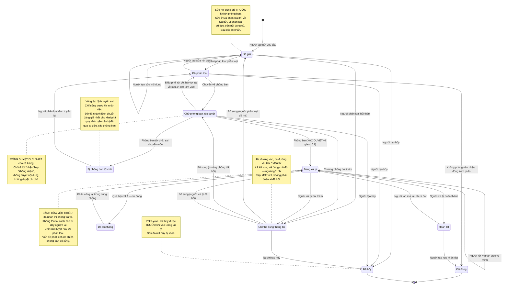

# Luồng nghiệp vụ — Cổng vận hành yêu cầu nội bộ

Sơ đồ trạng thái mô tả vòng đời một yêu cầu nội bộ, từ lúc người tạo gửi yêu cầu tới khi
đóng. Đây là bản thiết kế tham chiếu cho máy trạng thái của không gian `P`.

**Toàn bộ trạng thái, quy tắc chuyển, vai trò, phòng ban và ngưỡng SLA phải nằm trong bảng
dữ liệu, không mã cứng trong mã nguồn.** Xem `ARCHITECTURE.md` mục 5.

> **Cập nhật 10/09/2026** theo buổi trao đổi với giảng viên hướng dẫn: năm vai trò thay cho
> bốn, thêm chặng định tuyến phòng ban, và bỏ cổng phê duyệt chi phí. Xem mục 8.
>
> **Cập nhật 24/09/2026** theo ADR-0005, giảng viên đã duyệt: người tạo sửa được nội dung
> trước khi hồ sơ tới phòng ban, người xử lý tự nhận được hồ sơ chưa giao ai. Hai thao tác
> này là cạnh — hai trong số đó tự trỏ — nên luồng có hai mươi bốn cạnh. Xem mục 3.
>
> **Cập nhật 12/10/2026** theo quyết định của giảng viên ngày 08/10 (#142): hồ sơ nằm im ở *Chờ
> phòng ban xác duyệt* thì điều phối viên rút về được, và hết 24 giờ làm việc thì hệ thống tự
> trả về. Luồng có hai mươi sáu cạnh.

---

## 1. Sơ đồ trạng thái

---

## 2. Mười trạng thái

Cột **Định danh** là giá trị thật lưu trong bảng `states` và trong hai trường `from_state`,
`to_state` của nhật ký sự kiện. Dùng tiếng Anh vì mã nguồn so sánh với chúng; cột **Nhãn**
là chuỗi hiển thị cho người dùng. Theo quy ước ở `ARCHITECTURE.md` mục 8.3.

| # | Định danh | Nhãn hiển thị | Ý nghĩa | Kết thúc |
|---|---|---|---|---|
| 1 | `submitted` | Đã gửi | Người tạo vừa gửi, chờ phân loại | |
| 2 | `classified` | Đã phân loại | Đã xác định loại yêu cầu và phòng ban phụ trách | |
| 3 | `awaiting-acceptance` | Chờ phòng ban xác duyệt | Đã chuyển về phòng, chờ họ nhận hoặc từ chối | |
| 4 | `in-progress` | Đang xử lý | Phòng ban **đã nhận** và giao người xử lý | |
| 5 | `completed` | Hoàn tất | Người xử lý báo xong, chờ người tạo xác nhận | |
| 6 | `closed` | Đã đóng | | ✅ |
| 7 | `awaiting-info` | Chờ bổ sung thông tin | Hỏi ngược **người tạo**, không phải trả về phòng ban | |
| 8 | `rejected-by-department` | Bị phòng ban từ chối | Sai chuyên môn, cần định tuyến lại | |
| 9 | `escalated` | Đã leo thang | Quá hạn SLA, đẩy lên cấp trên **trong cùng phòng ban** | |
| 10 | `cancelled` | Đã hủy | Người tạo rút yêu cầu | ✅ |

---

## 3. Hai mươi sáu cạnh chuyển trạng thái

Đây là nội dung của bảng `transitions`. Mỗi dòng là một cạnh hợp lệ; **không có dòng nghĩa
là không đi được**.

| Từ | Sang | Hoạt động | Vai trò được phép |
|---|---|---|---|
| `submitted` | `classified` | Phân loại yêu cầu | `classifier` |
| `submitted` | `awaiting-info` | Yêu cầu bổ sung thông tin | `classifier` |
| `submitted` | `submitted` | Sửa nội dung | `requester` |
| `submitted` | `cancelled` | Hủy yêu cầu | `requester` |
| `classified` | `awaiting-acceptance` | Chuyển về phòng ban | `classifier` |
| `classified` | `submitted` | Sửa nội dung | `requester` |
| `classified` | `cancelled` | Hủy yêu cầu | `requester` |
| `classified` | `closed` | Đóng hồ sơ, không phòng nào nhận | `classifier` |
| `awaiting-acceptance` | `in-progress` | **Xác duyệt và giao xử lý** | `approver` |
| `awaiting-acceptance` | `awaiting-info` | Yêu cầu bổ sung thông tin | `approver` |
| `awaiting-acceptance` | `rejected-by-department` | Từ chối vì sai chuyên môn | `approver` |
| `awaiting-acceptance` | `cancelled` | Hủy yêu cầu | `requester` |
| `awaiting-acceptance` | `classified` | Rút hồ sơ về điều phối — bắt buộc lý do | `classifier` |
| `awaiting-acceptance` | `classified` | Tự trả về điều phối — hết 24 giờ làm việc chờ, báo trước 4 giờ | **hệ thống** |
| `rejected-by-department` | `classified` | Định tuyến lại phòng khác | `classifier` |
| `in-progress` | `in-progress` | Nhận việc về mình | `handler` |
| `in-progress` | `awaiting-info` | Yêu cầu bổ sung thông tin | `handler` |
| `in-progress` | `escalated` | Leo thang do quá hạn | **hệ thống** |
| `in-progress` | `completed` | Hoàn thành xử lý | `handler` |
| `escalated` | `in-progress` | Phân công lại trong cùng phòng | `approver` |
| `awaiting-info` | `submitted` | Bổ sung thông tin | `requester` |
| `awaiting-info` | `awaiting-acceptance` | Bổ sung thông tin | `requester` |
| `awaiting-info` | `in-progress` | Bổ sung thông tin | `requester` |
| `awaiting-info` | `cancelled` | Hủy yêu cầu | `requester` |
| `completed` | `closed` | Xác nhận đạt | `requester` |
| `completed` | `in-progress` | Mở lại, chưa đạt | `requester` |

**Chờ bổ sung thông tin quay về đúng chỗ đã hỏi** (#79, navigator chốt ngày 23/09). Ba nơi
hỏi thêm được — điều phối ở *Đã gửi*, trưởng phòng ở *Chờ phòng ban xác duyệt*, người xử lý ở
*Đang xử lý* — và ba cạnh trả lời quay về đúng ba nơi đó. Ràng buộc `return-to-previous-state`
đọc nhật ký sự kiện để biết hồ sơ vào *Chờ bổ sung thông tin* từ đâu, và chỉ cho đi cạnh về
đúng chỗ đó. Người gửi thấy **một** nút *Bổ sung thông tin*, gõ câu trả lời vào ô bắt buộc,
và hồ sơ tự về tay người đã hỏi.

Hệ quả đáng chú ý: hỏi ở *Đã gửi* thì trả lời xong hồ sơ về lại *Đã gửi*, chứ không nhảy sang
*Đã phân loại* như trước. Hồ sơ vì thế phải đi qua đúng cạnh phân loại cùng ràng buộc mức ưu
tiên của nó — lối vòng phát hiện ở #78, nơi hồ sơ vào tận phòng ban mà chưa có mức ưu tiên,
đã đóng.

**Cạnh tự trỏ: đổi hồ sơ mà giữ nguyên trạng thái** (ADR-0005, #127). *Sửa nội dung* ở *Đã
gửi* và *Nhận việc về mình* ở *Đang xử lý* đi từ một trạng thái về chính nó. Chúng vẫn là
cạnh, vì chúng đổi hồ sơ — nội dung, người xử lý — và mọi thay đổi trên hồ sơ phải để lại
một dòng nhật ký kèm giá trị cũ. Thao tác **không** đổi gì trên hồ sơ, như nhắn điều phối
viên hay hỏi tiến độ, không phải cạnh: chúng vào bảng lời nhắn riêng (#128). Ba điều giữ cho
cạnh tự trỏ không làm rối đồ thị:

- Mỗi trạng thái **tối đa một** cạnh tự trỏ của người — lược đồ giữ `UNIQUE (bộ quy tắc, từ,
  sang, is_system)`
- **Không có** cạnh tự trỏ ở trạng thái chờ người khác, như *Chờ bổ sung thông tin* — phép
  kiểm đồ thị số 7 trong `infra/seed/99-kiem-tra-tinh-nhat-quan.sql` từ chối dữ liệu như vậy
- Dòng nhật ký tự trỏ không đưa hồ sơ vào trạng thái nào, nên ràng buộc
  `return-to-previous-state` bỏ qua nó khi tìm chỗ cũ, và dòng thời gian không gọi nó là
  quay lui

**Sửa nội dung ở *Đã phân loại* thì hồ sơ về *Đã gửi***, không tự trỏ: phân loại, mức ưu
tiên, phòng ban dự kiến đều dựa trên nội dung cũ, nên người phân loại phải xem lại.

**Hạn chờ: hồ sơ không nằm im mãi** (#142, giảng viên chốt ngày 08/10). Trạng thái chờ một
người bấm có thể mang một cạnh hệ thống **tự đi** khi hồ sơ nằm đó đủ một số giờ làm việc
(`transitions.auto_after_hours`), và màn hình báo trước khi còn `warn_before_hours`. Hiện có
một: *Chờ phòng ban xác duyệt* tự trả về *Đã phân loại* sau 24 giờ làm việc, báo trước 4 giờ
trên hàng đợi phòng ban, hàng đợi điều phối và thẻ hạn của trang hồ sơ. Trước hạn, điều phối
viên rút về bằng tay được, có lý do — vì cạnh này mà *Chờ phòng ban xác duyệt* có mặt trong
hàng đợi điều phối. Hai cạnh cùng cặp trạng thái, một của người, một của hệ thống: lược đồ giữ
`UNIQUE (bộ quy tắc, từ, sang, is_system)`. Phòng cũ giữ lại tới khi điều phối chọn phòng mới,
như hồ sơ bị phòng ban từ chối. Tự trả về và rút về **không** là cạnh làm lại — phòng ban
không chê nội dung (navigator chốt 12/10). Nhật ký ghi tác nhân `wait-watcher` cho lần tự đi,
tách khỏi `sla-watcher` của leo thang.

**Cạnh làm lại** (#153, navigator chốt ngày 02/10). Ba cạnh mang cờ `is_rework` trong dữ
liệu: *Từ chối vì sai chuyên môn*, *Mở lại, chưa đạt*, và *Sửa nội dung* từ *Đã phân loại*
về *Đã gửi*. Dòng thời gian đếm "quay lui" là số lần hồ sơ đi qua các cạnh này — hồ sơ bị
đẩy ngược để làm lại. Hỏi đáp bổ sung thông tin hay phân công lại sau leo thang thì không
tính: hồ sơ đi vòng rồi về đúng chỗ cũ, không ai phải làm lại gì. Đổi cạnh nào là làm lại
thì sửa dữ liệu khởi tạo.

---

## 4. Năm vai trò

| Định danh | Nhãn hiển thị | Trách nhiệm |
|---|---|---|
| `requester` | Người tạo yêu cầu | Gửi yêu cầu, sửa nội dung trước khi hồ sơ tới phòng ban, bổ sung thông tin, hủy khi được phép, xác nhận hoặc mở lại |
| `classifier` | Người phân loại yêu cầu | Phân loại, chọn phòng ban phụ trách, **đặt mức ưu tiên**, hỏi thêm thông tin, định tuyến lại khi bị từ chối |
| `handler` | Người xử lý yêu cầu | Tự nhận hồ sơ chưa giao ai trong phòng, thực hiện công việc, hỏi thêm thông tin khi cần, báo hoàn thành |
| `approver` | Người xét duyệt yêu cầu | Quyết định phòng ban **nhận hay không nhận**, hỏi thêm thông tin trước khi nhận, phân công lại khi leo thang |
| `administrator` | Quản trị viên | **Không đi cạnh nào.** Quản lý phòng ban, loại yêu cầu, ngưỡng SLA, bảng ánh xạ loại → phòng |

Vai trò `classifier` về sau sẽ được tầng `I` hỗ trợ bằng phân loại tự động. Nhưng theo
nguyên tắc bất di dịch ở `ARCHITECTURE.md` mục 2.2, **AI chỉ ghi vào trường gợi ý**, con
người vẫn bấm nút quyết định.

---

## 5. Bốn ràng buộc Poka-yoke

| Ràng buộc | Cách thực thi |
|---|---|
| **Đã nhận là không trả về** | Không tồn tại cạnh nào từ `in-progress` ngược về `awaiting-acceptance` hay `classified`. Không phải *không nên đi*, mà là **không có đường mà đi** |
| **Chỉ hủy trước khi vào xử lý** | Cạnh `cancelled` chỉ xuất phát từ `submitted`, `classified`, `awaiting-acceptance`, `awaiting-info` |
| **Người tạo không tự đặt mức ưu tiên** | Ưu tiên do `classifier` đặt ở cạnh `submitted → classified`, và **chỉ ở cạnh đó** — engine từ chối `priority_code` gửi kèm bất kỳ cạnh nào khác |
| **Leo thang không đổi phòng ban** | Cạnh `escalated → in-progress` giữ nguyên phòng, chỉ đổi người phụ trách |

Mọi ràng buộc cài đặt ở **cả hai phía**: giao diện chặn để trải nghiệm tốt, dịch vụ chặn để
bảo đảm toàn vẹn. Chỉ chặn ở giao diện là không đủ.

**Leo thang lại sau khi phân công lại hay mở lại** (quyết định ngày 23/09, #94). Hồ sơ đã
quá hạn mà được phân công lại, được người gửi mở lại, hay vừa bổ sung thông tin xong thì
người nhận có một **khoảng ân hạn** trước khi bị leo thang lần nữa. Đồng hồ tổng **không**
đặt lại và **không** cấp hạn mới: hồ sơ vẫn được ghi nhận là quá hạn. Hết ân hạn mà vẫn
chưa xong thì leo thang lại. Không có ân hạn thì bộ quét leo thang lại ngay lượt kế tiếp,
và người được giao không có một phút nào để làm.

**Một ràng buộc bổ trợ, thêm ở #78 — cần giảng viên xác nhận:** hồ sơ rời khỏi tay người
phân loại phải có loại yêu cầu. Giữ loại người gửi đã chọn trên biểu mẫu, hoặc người phân
loại đặt mới nếu người gửi bỏ trống. Lý do: loại yêu cầu quyết định ngưỡng SLA, và hồ sơ
không có loại sẽ không bao giờ bị bộ quét đánh dấu quá hạn.

**Hai ràng buộc thêm ở #127** (ADR-0005, giảng viên duyệt ngày 24/09):

- **Chỉ sửa nội dung trước khi tới phòng ban.** Cạnh *Sửa nội dung* chỉ xuất phát từ
  `submitted` và `classified` — khóa bằng sự vắng mặt của cạnh, như ràng buộc chỉ hủy trước
  khi vào xử lý. Phòng ban đã cầm hồ sơ thì người tạo muốn nói thêm phải dùng lời nhắn.
  Sửa là thay giá trị trên hồ sơ, còn bản gốc nằm lại trong nhật ký, nên tầng `I` vẫn dựng
  lại được văn bản lúc người phân loại quyết định. Người tạo vẫn không đặt được mức ưu tiên
- **Không giành việc đã giao.** *Nhận việc về mình* chỉ đi được khi hồ sơ chưa giao ai, và
  người nhận luôn là chính người bấm — không gửi kèm được người khác. Muốn đổi người thì
  trưởng phòng phân công lại

**Không tự điều phối hồ sơ của mình** (#154, navigator chốt ngày 02/10). Ràng buộc
`actor-not-requester` gắn vào **mọi cạnh của vai điều phối** — phân loại, hỏi thêm ở *Đã
gửi*, chuyển phòng ban, định tuyến lại, đóng hồ sơ không phòng nào nhận. Một người vừa gửi
yêu cầu vừa là điều phối viên thì không tự phân loại, tự đặt mức ưu tiên cho yêu cầu của
mình: ràng buộc *người tạo không tự đặt mức ưu tiên* ở trên sẽ bị vòng qua nếu thiếu nó.
Trên hồ sơ của chính mình các nút đó không hiện, hàng đợi ghi *Bạn gửi — người khác điều
phối*, và dịch vụ từ chối nếu gửi thẳng. **Chỉ ở bước điều phối**: cạnh của phòng ban không
gắn — nhân viên CNTT gửi yêu cầu sửa máy mình rồi tự sửa là bình thường.

---

## 6. Nhật ký sự kiện

Mọi lần chuyển trạng thái đều ghi một bản ghi với lược đồ `case_id`, `activity`,
`timestamp` (UTC), `actor`, `from_state`, `to_state`. Đây là nguồn dữ liệu cho khai phá
quy trình ở không gian `I`.

Cơ chế bảo đảm nhật ký không bao giờ thiếu bản ghi: **một cửa duy nhất** — mọi lần đổi
trạng thái đi qua đúng một điểm trong mã. Xem `ARCHITECTURE.md` mục 6.1.

Dòng của cạnh tự trỏ có `from_state` bằng `to_state`. Với khai phá quy trình, đó vẫn là một
hoạt động có thật: khoảng từ lúc hồ sơ vào *Đang xử lý* tới lúc có người *Nhận việc về
mình* đo đúng thời gian hồ sơ nằm chờ không ai cầm.

**Lời nhắn không vào nhật ký sự kiện** (#128, ADR-0005). Lời nhắn không đổi hồ sơ nên không
phải cạnh, và nằm ở bảng riêng `case_messages`, cũng chỉ ghi thêm. Luật chốt với navigator
ngày 24/09/2026:

- **Hai chiều.** Người gửi và nhân viên đều nhắn được; ai mở được hồ sơ thì nhắn được
- **Hồ sơ kết thúc thì chỉ đọc**
- **Hỏi tiến độ** là loại riêng của người gửi, chỉ khi hồ sơ nằm ở phòng ban — hiện là *Chờ
  phòng ban xác duyệt*, *Đang xử lý*, *Đã leo thang*, suy từ bộ quy tắc. Hỏi lại chỉ được
  khi phòng ban đã trả lời, hoặc đã quá bốn giờ mà chưa ai trả lời
- Hàng đợi hiện dấu *Người gửi đang chờ trả lời* khi lời nhắn sau cùng là của người gửi

**Trò chuyện nội bộ** (#156) là loại lời nhắn *Nhắn nội bộ* mang cờ `hidden_from_requester`
trong `message_kinds`: chỉ nhân viên đang mở được hồ sơ — điều phối, phòng đang giữ — đọc và
nhắn được. Ví dụ điều phối viên hỏi trưởng phòng "phòng chị nhận vụ này không?" khi hồ sơ đang
chờ phòng xác duyệt, trước khi trả qua trả lại (nhánh B). Chốt với navigator ngày 04/10 và
06/10/2026:

- **Người gửi của hồ sơ không thấy**, kể cả khi họ cũng là nhân viên — ràng buộc theo hồ sơ,
  không theo vai trò. Dịch vụ lọc ở mọi điểm cuối, giao diện chỉ là lớp thứ hai
- **Không làm lệch luật lời nhắn thường**: không tính vào *Người gửi đang chờ trả lời*, không
  phải là "đã trả lời" trong luật hỏi lại của *Hỏi tiến độ*
- **Hồ sơ kết thúc thì chỉ đọc**, như mọi lời nhắn
- Cũng không đổi hồ sơ và không vào nhật ký sự kiện

**Hộp thư chung** (#155) gom lời nhắn của mọi hồ sơ một người đang giữ — không phải kho tin
nhắn thứ hai, mỗi cuộc trò chuyện là lời nhắn của một hồ sơ. Phạm vi theo việc đang giữ,
chốt với navigator ngày 05/10/2026: người gửi thấy hồ sơ của mình, phòng ban thấy mọi hồ sơ
của phòng có lời nhắn — người mới được giao lại đọc được trao đổi cũ —, điều phối viên thấy
hồ sơ đang ở hàng đợi điều phối và hồ sơ mình đã từng nhắn. Từ #156 một hồ sơ có thể có hai
cuộc: với người gửi, và nội bộ — cuộc nội bộ vào nhóm *Nội bộ nhân viên* có ổ khóa, không có
dấu *Đang chờ bạn*. Đánh dấu *đã đọc* nằm ở bảng `case_message_reads`, mỗi cuộc một mốc, cũng
**không vào nhật ký sự kiện** và không chạm dòng hồ sơ: đọc không phải là một hoạt động của
quy trình.

Khác *Yêu cầu bổ sung thông tin*: cạnh đó đổi trạng thái, dừng đồng hồ và bắt người gửi phải
trả lời thì hồ sơ mới đi tiếp. Lời nhắn thì không đổi gì và không bắt ai làm gì. Với khai
phá quy trình, bảng lời nhắn là nguồn thứ hai: số lần hỏi tiến độ và thời gian chờ trả lời
chỉ ra điểm nghẽn mà nhật ký trạng thái không thấy — trước đây là những cuộc gọi không để lại
dấu vết.

**Hai mẫu lệch chuẩn đáng theo dõi nhất**, đều lộ ra từ nhật ký:

- **Vòng lặp định tuyến sai**: `classified → awaiting-acceptance → rejected-by-department →
  classified` lặp nhiều lần. Cho thấy bảng ánh xạ loại yêu cầu sang phòng ban đang sai, hoặc
  ranh giới trách nhiệm giữa các phòng chưa rõ
- **Cạnh đi ngược sau khi đã nhận**: nếu nhật ký xuất hiện cạnh nào từ `in-progress` về phía
  trước, đó là bằng chứng có người lách quy trình bằng đường khác

---

## 7. Chiều dữ liệu cấu hình được

Ngoài trạng thái và quy tắc chuyển, ba nhóm sau cũng là **dữ liệu**, không mã cứng:

| Nhóm | Ví dụ | Ai sửa |
|---|---|---|
| **Phòng ban** | Công nghệ thông tin, Nhân sự, Hành chính, Tài chính kế toán | `administrator` |
| **Loại yêu cầu** | Sự cố thiết bị, cấp quyền phần mềm, giấy xác nhận nhân sự, đề xuất mua vật tư | `administrator` |
| **Ánh xạ loại → phòng ban** | Sự cố thiết bị → Công nghệ thông tin | `administrator` |
| **Ngưỡng SLA** | Theo từng loại yêu cầu, tính bằng **giờ làm việc** | `administrator` |
| **Ân hạn sau khi vào lại xử lý** | Theo từng loại yêu cầu, mẫu là một phần tư ngưỡng SLA, cũng là giờ làm việc | `administrator` |
| **Lịch làm việc** | Khung giờ làm theo thứ, ngày nghỉ, múi giờ — mẫu: thứ Hai–thứ Sáu 08:00–12:00 và 13:00–17:00, giờ Việt Nam, ngày nghỉ lễ 2026 (#199) | `administrator` |

Yêu cầu này không chỉ để thích ứng đề thi tháng 11. Mục tiêu sản phẩm là **doanh nghiệp
khác tải về rồi tự tùy biến phòng ban và loại yêu cầu theo đặc thù của mình** — đó là lý do
tồn tại của vai trò `administrator`.

---

## 8. Những thay đổi so với bản trước

Bản đầu tiên (20/08/2026) dựng theo mô hình bốn vai trò và không có chặng phòng ban. Buổi
trao đổi với giảng viên ngày 10/09/2026 đổi ba điểm:

| Thay đổi | Chi tiết |
|---|---|
| **Bốn → năm vai trò** | Thêm `administrator`. Điều phối viên đổi trọng tâm thành **người phân loại** |
| **Thêm chặng định tuyến phòng ban** | `classified → awaiting-acceptance → in-progress`, kèm vòng lặp trả về khi sai chuyên môn |
| **Bỏ cổng phê duyệt chi phí** | Trạng thái `Chờ phê duyệt` cũ **không còn**. Khi phát sinh chi phí, người phụ trách phòng lập **một phiếu yêu cầu mới** theo luồng riêng — đó là hồ sơ khác, không phải trạng thái của hồ sơ này |

**Hai điểm suy luận, chưa có xác nhận của giảng viên**, cần đính chính nếu sai:

1. **Cạnh `classified → closed`** cho trường hợp không phòng nào nhận. Không có cạnh này thì
   hồ sơ có thể luẩn quẩn vô hạn giữa định tuyến và từ chối
2. **Cạnh `completed → in-progress`** cho người tạo mở lại khi chưa đạt. Không mâu thuẫn
   nguyên tắc *đã nhận là không trả về*, vì hồ sơ ở lại đúng phòng ban đã nhận
